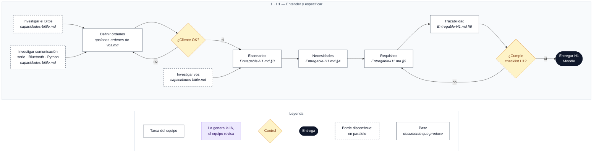

# H1 · Especificación inicial: escenarios y requisitos

**Objetivo:** demostrar que habéis comprendido el problema y que sois capaces de transformar situaciones de uso en requisitos concretos, justificados y verificables, antes de empezar a desarrollar el software.

**Entrega:** por Moodle (la plantilla es opcional).

**Mínimo exigido:** escenario nominal y excepcional; requisitos verificables para **las dos órdenes válidas** y **la entrada no reconocida**; relación entre escenarios, necesidades y requisitos.

## Contenido esperado

| Contenido | ¿Qué se espera? |
|---|---|
| 1. Investigación técnica | Análisis de las capacidades del Bittle, movimientos disponibles, alternativas de reconocimiento de voz, posibilidades de integración y restricciones identificadas. |
| 2. Escenarios operacionales | Todos los escenarios nominales y excepcionales relevantes que la empresa sea capaz de identificar. Deben cubrir las situaciones de uso previstas, las interacciones, los comportamientos alternativos y las condiciones de fallo. |
| 3. Necesidades de los stakeholders | Identificación y justificación de las necesidades derivadas del encargo y de los escenarios. |
| 4. Requisitos del sistema | Conjunto completo de requisitos identificados por la empresa, tanto funcionales como de calidad, redactados de forma clara, inequívoca y verificable. |
| 5. Trazabilidad | Relación entre escenarios, necesidades y requisitos, identificando su origen y cómo se comprobará cada requisito. |

> La trazabilidad permite saber qué requisitos tocar si el cliente cambia algo (en H4 llegará la solicitud de cambio CR-01).

## Paso 1 · Comprender el encargo

Investigar las capacidades y limitaciones del robot Bittle y las tecnologías necesarias para controlarlo por voz. A partir de esa información, definir escenarios de uso nominales y excepcionales que sean realistas.

| Para investigar… | Fuente | Qué buscar |
|---|---|---|
| Capacidades del Bittle | [Petoi Doc Center](https://docs.petoi.com/) | Características, movimientos disponibles, conexiones y limitaciones del robot. |
| Movimientos y órdenes | [Petoi – Serial Protocol](https://docs.petoi.com/apis/serial-protocol) | Cómo se identifican y ejecutan los movimientos; qué acciones podrían utilizarse. |
| Programación e integración | [Petoi – Python API](https://docs.petoi.com/apis/python-api) | Cómo comunicarse con el robot desde Python y qué dependencias se necesitan. |
| Escenarios operacionales | [SEBoK – Operational Scenario](https://sebokwiki.org/wiki/Operational_Scenario_(glossary)) | Qué es un escenario operacional y cómo relaciona sistema, usuarios y entorno. |
| Cómo describir escenarios | [Sommerville – Features, Scenarios and Stories](https://iansommerville.com/engineering-software-products/features-scenarios-and-stories/) | Cómo describir situaciones de uso, interacciones y resultados esperados. |

En Moodle también está la documentación del robot: API, protocolo serie y Bluetooth.

## Paso 2 · Especificar

Identificar qué necesitan los stakeholders a partir de los escenarios operacionales y transformar esas necesidades en requisitos claros, justificables y verificables.

| Para aprender… | Fuente | Qué consultar |
|---|---|---|
| Identificar las necesidades de los stakeholders | [SEBoK – Stakeholder Needs Definition](https://sebokwiki.org/wiki/Stakeholder_Needs_Definition) | Cómo identificar, formular y justificar las necesidades a partir del problema y los escenarios. |
| Transformar necesidades en requisitos | [SEBoK – System Requirements Definition](https://sebokwiki.org/wiki/System_Requirements) | Cómo derivar obligaciones técnicas del sistema y relacionarlas con las necesidades de origen. |
| Redactar buenos requisitos | [NASA – How to Write a Good Requirement (Appendix C)](https://www.nasa.gov/reference/system-engineering-handbook-appendix/) | Criterios de claridad, precisión, consistencia, viabilidad, trazabilidad y verificabilidad. |
| Revisar la cobertura de los requisitos | [NASA – Requirements Verification Matrix (Appendix D)](https://www.nasa.gov/reference/system-engineering-handbook-appendix/) | Cómo vincular requisitos con métodos de verificación y comprobar que ninguno queda sin evaluar. |

## Documentos de trabajo

- [`capacidades-bittle.md`](capacidades-bittle.md): investigación técnica del robot (punto 1).
- [`comandos-bittle-estandar-seguros.md`](comandos-bittle-estandar-seguros.md): los 45 comandos seguros del Bittle estándar (catálogo del sistema).
- [`ordenes-modulo-voz-petoi.md`](ordenes-modulo-voz-petoi.md): las 40 órdenes oficiales del módulo de voz de Petoi, con su comando.
- [`opciones-ordenes-de-voz.md`](opciones-ordenes-de-voz.md): órdenes candidatas en tres tiers.
- [`propuesta-requisitos-funcionales-por-tiers.md`](propuesta-requisitos-funcionales-por-tiers.md): versión limpia de los tres niveles, para enseñar al cliente.
- [`plantilla-H1.md`](plantilla-H1.md): plantilla para rellenar el entregable H1.
- [`preguntas-para-el-cliente.md`](preguntas-para-el-cliente.md): preguntas para el profesor y datos que faltan.

## Flujo de trabajo

Cada caja indica en cursiva el documento que produce. Leyenda debajo del diagrama.

### Pasos

**A la vez:**
- [ ] Investigar el Bittle: movimientos, conexiones, limitaciones → `capacidades-bittle.md`
- [ ] Investigar la comunicación: protocolo serie, Bluetooth, API de Python → `capacidades-bittle.md`
- [ ] Investigar el reconocimiento de voz: alternativas y restricciones → `capacidades-bittle.md`

**Después, en orden:**
- [ ] Definir las órdenes y validarlas con el cliente (Teams). Si no las acepta, se redefinen → `opciones-ordenes-de-voz.md`
- [ ] Escribir los escenarios nominales y excepcionales → `Entregable-H1.md §3`
- [ ] Sacar de ellos las necesidades → `Entregable-H1.md §4`
- [ ] Redactar los requisitos (criterios de la NASA) → `Entregable-H1.md §5`
- [ ] Montar la trazabilidad y el método de verificación → `Entregable-H1.md §6`

**Antes de entregar:** comprobar la tabla «Contenido esperado». Si falla algo, se vuelve a los requisitos.

**Entrega:** Moodle.
