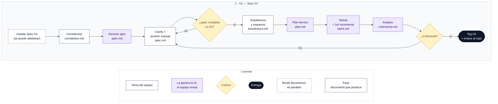

# H2 · Especificación y planificación con Spec Kit

**Objetivo:** demostrar que la empresa ha transformado los requisitos de H1 en una especificación coherente y que tiene un plan técnico y unas tareas lo bastante definidos para empezar la implementación.

**Entregables:** `spec.md`, `plan.md` y `tasks.md`. **Se entrega el enlace a este repositorio.**

**Mínimo exigido:** especificación revisada, decisiones técnicas justificadas, esquema sencillo del sistema, tareas organizadas y primer incremento identificado.

## Contenido esperado

| Contenido | ¿Qué se espera? |
|---|---|
| 1. Repositorio Git | Repositorio propio, organizado, con los documentos del proyecto y un historial de cambios identificable. |
| 2. Especificación (`spec.md`) | Especificación generada con Spec Kit, revisada y completada por la empresa. Debe recoger los escenarios, requisitos, casos excepcionales y criterios de aceptación identificados. |
| 3. Esquema del sistema | Representación sencilla de los componentes principales, sus responsabilidades, conexiones e intercambios de información. |
| 4. Plan de implementación (`plan.md`) | Decisiones técnicas justificadas: tecnologías, interfaces, dependencias, estructura del software, restricciones y estrategia de integración y pruebas. |
| 5. Plan de tareas (`tasks.md`) | Conjunto de tareas necesarias para implementar y verificar el sistema, organizadas según sus dependencias y con resultados comprobables. |
| 6. Coherencia y trazabilidad | Correspondencia entre los requisitos de H1, `spec.md`, las decisiones de `plan.md` y las tareas de `tasks.md`. Identificación de decisiones pendientes y riesgos técnicos. |

## Paso 3 · Explorar Spec Kit

Crear el repositorio de la empresa, elegir y configurar un entorno de desarrollo con IA, y usar GitHub Spec Kit para transformar el análisis de H1 en una especificación estructurada (`spec.md`), revisada y coherente.

| Para aprender… | Fuente | Qué consultar |
|---|---|---|
| Qué es Spec Kit | [GitHub Spec Kit](https://github.com/github/spec-kit) | Qué es el Specification-Driven Development (SDD) y cómo se organiza el trabajo a partir de una especificación. |
| Instalar y configurar | [Guía oficial de instalación](https://github.github.com/spec-kit/installation.html) | Requisitos previos, instalación, inicialización y selección del agente de programación. |
| Seguir el flujo básico | [Spec Kit – Quickstart](https://github.github.com/spec-kit/quickstart.html) | Secuencia de trabajo: especificar → planificar → generar tareas → implementar. |
| Elegir el entorno | [Integraciones compatibles](https://github.github.com/spec-kit/reference/integrations.html) | Qué agentes admite Spec Kit y cómo se ejecutan sus operaciones en cada uno. |
| Crear y gestionar el repositorio | [GitHub – Primeros pasos con repositorios](https://docs.github.com/es/repositories/creating-and-managing-repositories/quickstart-for-repositories) | Crear un repositorio, incorporar archivos y mantener un historial de cambios. |
| Conocer `spec.md` | [Plantilla oficial de especificación](https://github.com/github/spec-kit/blob/main/templates/spec-template.md) | Historias de usuario, escenarios de aceptación, casos límite, requisitos funcionales y criterios de éxito. |

## Paso 4 · Planificar

Definir cómo se va a construir el sistema, identificar sus componentes principales y usar Spec Kit para generar y revisar un plan técnico (`plan.md`) y un conjunto organizado de tareas de implementación (`tasks.md`).

| Para aprender… | Fuente | Qué consultar |
|---|---|---|
| Planificar con Spec Kit | [Spec Kit – Quickstart](https://github.github.io/spec-kit/quickstart.html) | Cómo usar las operaciones de planificación y generación de tareas a partir de `spec.md`. |
| Conocer `plan.md` | [Plantilla oficial de plan.md](https://github.com/github/spec-kit/blob/main/templates/plan-template.md) | Contexto técnico, dependencias, restricciones, decisiones de diseño y organización del proyecto. |
| Conocer `tasks.md` | [Plantilla oficial de tasks.md](https://github.com/github/spec-kit/blob/main/templates/tasks-template.md) | Organización de tareas, dependencias, prioridades y criterios para implementar progresivamente. |
| Definir la arquitectura del sistema | [SEBoK – System Architecture Design](https://sebokwiki.org/wiki/System_Architecture_Design) | Cómo identificar los elementos del sistema, sus responsabilidades e interfaces. |
| Comprobar la coherencia de los documentos | [Spec Kit – Flujo de trabajo](https://github.github.io/spec-kit/quickstart.html) | Cómo analizar inconsistencias entre la especificación, el plan y las tareas antes de implementar. |

**Notas de la sesión (26/10):** definir vosotros la arquitectura (Bluetooth, otro ordenador, módulos de voz y órdenes) y dársela a Spec Kit para que organice el código. No dejar que Spec Kit funcione solo.

## Flujo de trabajo

Cada caja indica en cursiva el documento que produce. Leyenda debajo del diagrama.

### Pasos

- [ ] Instalar Spec Kit y elegir el agente (se puede adelantar durante el H1)
- [ ] Constitución: reglas fijas del proyecto que la IA debe respetar → `constitution.md`
- [ ] Generar la spec a partir del H1 (`/speckit.specify`) → `spec.md`
- [ ] Clarify (`/speckit.clarify`) y revisión manual: están todos los requisitos del H1, excepcionales incluidos, y no hay supuestos inventados → `spec.md`
- [ ] **Control:** ¿la spec está completa frente al H1? Si no, se vuelve a la revisión.
- [ ] Arquitectura y esquema del sistema (lo hace el equipo, no Spec Kit) → `arquitectura.md`
- [ ] Plan técnico (`/speckit.plan`) y su revisión → `plan.md`
- [ ] Tareas y primer incremento (`/speckit.tasks`) → `tasks.md`
- [ ] Analyze (`/speckit.analyze`): contradicciones, huecos, riesgos y decisiones pendientes → `coherencia.md`
- [ ] **Control:** ¿hay coherencia H1 → spec → plan → tasks? Si no, se vuelve a la revisión de la spec.
- [ ] Etiquetar la versión H2 en Git y entregar el enlace al repo

> Todos los documentos del H2 se guardan en esta carpeta. Cómo encajarlo con las rutas que usa Spec Kit se decide al instalarlo.

## Checklist de revisión

**1. Especificación: `spec.md`**
- [ ] Se han incorporado todos los requisitos relevantes identificados en H1, incluidos los comportamientos excepcionales.
- [ ] Los escenarios, requisitos y criterios de aceptación son claros, coherentes y verificables.
- [ ] Se han revisado las propuestas de Spec Kit, corrigiendo omisiones, contradicciones y suposiciones injustificadas.

**2. Diseño del sistema: esquema y `plan.md`**
- [ ] El esquema identifica los componentes principales, sus responsabilidades y las interfaces entre ellos.
- [ ] Las tecnologías, dependencias y decisiones técnicas están justificadas y son viables.
- [ ] Se han tenido en cuenta las restricciones del Bittle, la integración del reconocimiento de voz y las condiciones de seguridad.
- [ ] Se ha definido una estrategia para integrar los componentes y comprobar su funcionamiento.

**3. Planificación del trabajo: `tasks.md`**
- [ ] Las tareas cubren la implementación, la integración y la verificación de los requisitos.
- [ ] Cada tarea tiene un objetivo concreto y un resultado cuya finalización puede comprobarse.
- [ ] Las dependencias entre tareas permiten establecer un orden de desarrollo coherente.

**4. Coherencia y preparación**
- [ ] Existe correspondencia entre los requisitos de H1, `spec.md`, `plan.md` y `tasks.md`.
- [ ] Las incertidumbres, decisiones pendientes y riesgos técnicos están identificados.
- [ ] Los documentos y el esquema están guardados en el repositorio Git, con una versión H2 identificable.
- [ ] Cualquier integrante de la empresa puede explicar el plan y justificar las decisiones adoptadas.
