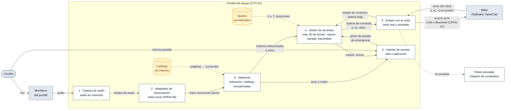
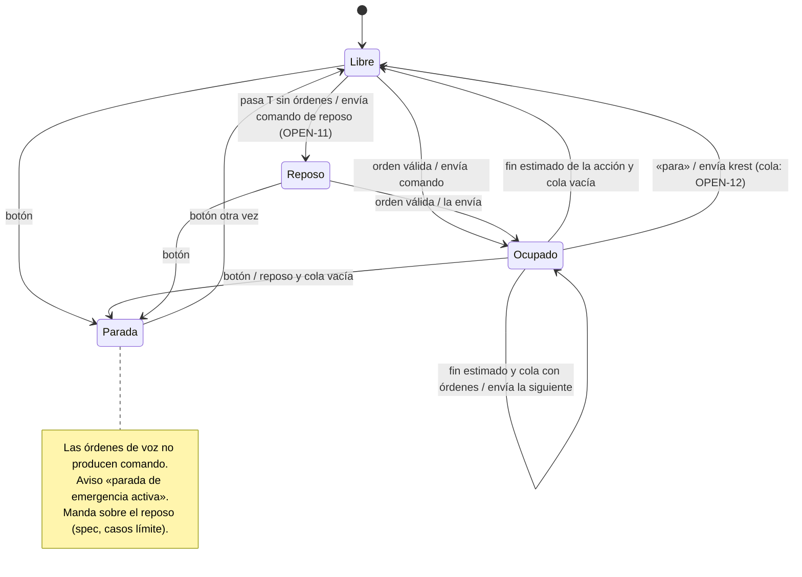

# Plan de implementación: control por voz del Petoi Bittle (VOICE-BITTLE)

**Hito**: H2 · **Estado**: borrador para revisar con el equipo · **Fecha**: 26/10/2026 · **Spec**: [`spec.md`](spec.md)

**Entrada**: `spec.md` (verificada contra H1), `H1-especificacion-inicial/Entregable-H1.md`, `H1-especificacion-inicial/capacidades-bittle.md`, `H1-especificacion-inicial/opciones-ordenes-de-voz.md` y `referencias/notas/`.

> **Cómo leer este documento.** Sigue la plantilla oficial de `plan.md` de Spec Kit (resumen, contexto técnico, comprobación de la constitución, estructura del proyecto, investigación, diseño y seguimiento de la complejidad), adaptada al reto. Los identificadores `ESC-`, `NEC-`, `REQ-`, `CTX-` y `OPEN-` son los de H1 y `spec.md`.
>
> Cada decisión lleva una de estas dos etiquetas:
>
> - **Fijada**: ya está escrita en H1, en `spec.md` o en las respuestas del cliente. Se cita la fuente.
> - **Propuesta, pendiente de confirmar por el equipo**: la sugiere este plan. Lleva alternativas y justificación. No se aplica hasta que el equipo la confirme.
>
> No se ha inventado ningún valor. Los números provisionales (5 s, 1,5 s, 80 %, ±45°, T = 5/15 min) vienen de `spec.md` y van en la configuración para poder cambiarlos sin tocar el código.

## Resumen

El sistema escucha al usuario con el micrófono del portátil del equipo, pasa la voz a texto con un módulo de transcripción existente, interpreta el texto con un intérprete propio (palabra de activación «Atenio», catálogo de órdenes, órdenes encadenadas) y envía al Bittle los comandos del protocolo serie de Petoi (`ksit`, `kup`…). Un gestor de acciones guarda las órdenes en una cola y las envía una a una, porque el robot no avisa al terminar una acción (CTX-05). Una interfaz muestra el texto, la orden, el estado de la conexión y los avisos, y tiene el botón de parada de emergencia.

El enfoque técnico se basa en tres ideas:

1. **Todo corre en el portátil; el robot solo recibe comandos** (CTX-01, fijada).
2. **El robot se ve a través de una interfaz única con dos versiones**: el enlace serie real y un robot simulado que registra los comandos. Así todas las pruebas funcionan sin el robot físico (REQ-26, CTX-08, fijada).
3. **El intérprete y el gestor de acciones trabajan con texto y con un reloj sustituible**, no con audio ni con el tiempo real. Así las pruebas automáticas no necesitan micrófono ni esperas largas (propuesta, ver D-08).

## Contexto técnico

| Campo de la plantilla | Valor | Estado y fuente |
|---|---|---|
| **Lenguaje/versión** | Python 3 (la API de Petoi pide Python ≥ 3.6). Versión exacta por fijar. | Propuesta (D-01). Fuente: `capacidades-bittle.md` §1 y §7; H1 §2.4. |
| **Dependencias principales** | `pyserial` (puerto serie); motor de transcripción local (Vosk o Faster-Whisper, por elegir); biblioteca de captura de audio (por elegir con el motor); marco de interfaz (por elegir, D-07). | `pyserial`: H1 §2.4 y `capacidades-bittle.md` §1 (pyserial 3.5). Motor: propuesta (D-02). El resto: pendiente. |
| **Almacenamiento** | Ninguno de audio (REQ-24). Solo dos ficheros de texto: catálogo de órdenes y ajustes. | Propuesta (D-05). |
| **Pruebas** | Marco de pruebas de Python (propuesta: `pytest`). Robot simulado, reloj simulado y frases de texto como entrada. | Propuesta (D-08, D-09). Sin robot físico: fijado (CLAUDE.md, REQ-26). |
| **Plataforma** | Portátil del equipo, con micrófono, pantalla y puerto serie (USB o Bluetooth). Sistema operativo por confirmar. | REQ-17, REQ-27, CTX-07. Ver «otro ordenador» en Decisiones pendientes (P-07). |
| **Tipo de proyecto** | Un solo programa local (sin servidor remoto) con interfaz web o de escritorio. | Interfaz web o aplicación: cliente 26/10, punto 9. Elección: propuesta (D-07). |
| **Objetivos de prestaciones** | Comando enviado < 1,5 s después del final de la frase `[provisional]`; ≥ 80 % de órdenes válidas acertadas en sala tranquila `[provisional]`; sigue operativo tras 20 entradas inválidas. | REQ-21, REQ-22, REQ-23; OPEN-02. |
| **Restricciones** | Robot Bittle con NyBoard sin módulo de voz (CTX-01); el robot no avisa al terminar (CTX-05); superficie lisa (CTX-06, REQ-28); no guardar audio (REQ-24); pruebas sin robot (REQ-26); avisos solo en pantalla (OPEN-09). | `spec.md` «Restricciones externas» y «Supuestos». |
| **Escala/alcance** | Un usuario, un robot, un portátil. 10 órdenes del Nivel 1 obligatorias; 3 del Nivel 2 opcionales; repertorio ampliable hasta las 40 órdenes programadas (NEC-07). | CTX-02; `spec.md` «Entidades clave». |

## Comprobación de la constitución

El repositorio todavía no tiene `constitution.md` (el flujo del `README.md` de H2 la pone antes de `spec.md`). Mientras no exista, este plan comprueba las reglas fijas de `CLAUDE.md`:

| Regla | ¿Se cumple? | Cómo |
|---|---|---|
| Requisitos y arquitectura los define el equipo, no la IA | Sí | Toda decisión no fijada va como propuesta pendiente de confirmar. |
| No inventar contenido | Sí | Cada dato cita su fuente. Los valores que faltan son pendientes. |
| Todo requisito se puede derivar a pruebas | Sí | Tabla «REQ → decisión del plan» con el nivel de prueba de cada uno. |
| Pruebas de H3 sin el robot físico | Sí | Robot simulado y reloj simulado (D-03, D-08). |
| No subir audios personales | Sí | Las pruebas automáticas usan texto, no grabaciones (D-09). |

## Esquema del sistema

### Componentes y conexiones

Las flechas indican qué información pasa de un componente a otro. Los componentes en blanco son código del equipo; los grises son externos.



### Responsabilidades e interfaces

| # | Componente | Responsabilidad | Recibe | Entrega | Requisitos |
|---|---|---|---|---|---|
| 1 | Captura de audio | Leer el micrófono y pasar el audio al adaptador. El audio se queda en memoria y no se escribe en el disco. | Audio del micrófono. | Bloques de audio. | REQ-17, REQ-24 |
| 2 | Adaptador de transcripción | Envolver el motor de transcripción elegido detrás de una interfaz única «audio → texto». Cambiar de motor no cambia el resto. | Bloques de audio. | Frase reconocida (texto) o «vacío». | REQ-18, REQ-21, REQ-24, OPEN-01, OPEN-06 |
| 3 | Intérprete | Normalizar el texto (minúsculas, sin tildes; H1 §2.4), detectar «Atenio», partir la frase en órdenes por las palabras de enlace, buscar cada orden en el catálogo y clasificar el resultado. No tiene estado salvo la espera de 5 s de REQ-35. | Frase reconocida; catálogo. | Una interpretación: lista de órdenes, «no entendida», «fuera del catálogo», «solo activación» o «ignorada (sin nombre)», con sus avisos. | REQ-01 a REQ-16, REQ-29, REQ-35 |
| 4 | Gestor de acciones | Mantener la cola, decidir cuándo ha terminado una acción, enviar el siguiente comando, tratar «para», la parada de emergencia y el reposo por inactividad, y bloquear el envío sin conexión. | Interpretaciones; botón de parada; estado del enlace; reloj. | Cadenas de comando al enlace; estado y avisos a la interfaz. | REQ-07, REQ-21, REQ-25, REQ-29 a REQ-32 |
| 5 | Enlace con el robot | Abrir el puerto, enviar cadenas en el formato del protocolo serie de Petoi, leer lo que devuelve el robot y avisar de batería baja. Dos versiones con la misma interfaz: serie real y simulado. | Cadenas de comando. | Resultado del envío; estado de conexión; líneas recibidas (p. ej. «Low power: 6.5V»). | REQ-20, REQ-25, REQ-26, REQ-33, REQ-34 |
| 6 | Interfaz de usuario | Mostrar el texto reconocido, la orden interpretada, el estado de la conexión y los avisos. Ofrecer el botón de parada de emergencia. | Eventos del intérprete y del gestor. | Pulsaciones del botón de parada. | REQ-19, REQ-30 |
| — | Catálogo de órdenes (datos) | Para cada orden: palabras que la dicen (con sinónimos, H1 §2.4), comando o lista de comandos, duración estimada de cada comando y si interrumpe. | — | — | REQ-02 a REQ-16, NEC-07 |
| — | Ajustes (datos) | Valores provisionales: 5 s (REQ-35), T demo/real (REQ-31), comando de reposo (OPEN-11), puerto y baudios (OPEN-07), máximo de órdenes por frase. | — | — | OPEN-02, OPEN-07, OPEN-11 |
| — | Robot simulado | Registrar cada cadena recibida con su hora; poder simular «sin conexión» y enviar líneas como «Low power». | Cadenas de comando. | Registro consultable por las pruebas. | REQ-26, REQ-20, REQ-25, REQ-33 |

### Estados del gestor de acciones



## Decisiones de diseño

| ID | Decisión | Estado | Alternativas | Justificación |
|---|---|---|---|---|
| D-01 | **Python 3** para todo el programa. | Propuesta, pendiente de confirmar por el equipo | Otro lenguaje con biblioteca serie. | La API de Petoi (`robot.py`, `sendSkillStr`) y `pyserial` son de Python (`capacidades-bittle.md` §1 y §7). Los motores de transcripción locales que cita H1 §2.4 (Vosk, Faster-Whisper) se nombran como «bibliotecas Python ligeras». |
| D-02 | **Tecnología de voz (bloqueo B1)**: transcripción **local, sin conexión**, con Vosk o Faster-Whisper (base/tiny), detrás de un adaptador único. El motor concreto se elige con un prototipo que mida la latencia (REQ-21) y si reconoce «Atenio» (OPEN-01) y las órdenes en español. | Propuesta, pendiente de confirmar por el equipo. H1 §2.4 se inclina por esta opción; OPEN-06 sigue abierto. | 1) Módulo de voz de Petoi: no está en la NyBoard (CTX-01). 2) Servicio en la nube: latencia según la red de la UPM, necesita credenciales y envía el audio fuera (H1 §2.4, OPEN-06). 3) Local sin conexión (propuesta). | Local evita la red en la demo y no envía el audio fuera (ayuda a cumplir REQ-24 y cierra OPEN-06 si se confirma). El adaptador permite cambiar de motor tras el prototipo sin tocar el intérprete. |
| D-03 | **Enlace con el robot detrás de una interfaz única** con dos versiones: serie real y simulado. | Fijada en lo esencial (REQ-26, CTX-08, H1 §2.4: «facilitando su sustitución por un mock»). La forma concreta es propuesta. | Probar con el robot físico cada vez: no cumple H3. | Es la condición para que todas las pruebas funcionen sin robot. |
| D-04 | **Conexión (bloqueo B2)**: el programa abre un **puerto serie** por nombre; USB y Bluetooth SPP aparecen los dos como puerto serie (H1 §2.2). Puerto y baudios van en los ajustes. Baudios iniciales: 115200 (CTX-07), por confirmar en el robot. Propuesta de uso: desarrollar con USB y probar Bluetooth en cuanto se valide el emparejamiento. | Propuesta, pendiente de confirmar por el equipo (OPEN-07). | Solo USB (más simple, cable en la demo); solo Bluetooth (lo que dijo el profesor el 26/10, pero el emparejamiento no está validado, CTX-07). | El mismo código vale para las dos vías, así la elección no bloquea el desarrollo. Hay una contradicción entre fuentes sobre los baudios (ver «Discrepancias detectadas»). |
| D-05 | **Catálogo de órdenes en un fichero de datos**, no en el código: palabras, comando(s), duración estimada y marca «interrumpe». | Propuesta, pendiente de confirmar por el equipo. | Tabla dentro del código. | Añadir órdenes (NEC-07, hasta las 40 programadas) o corregir `khi`/`ktrF` (OPEN-03) no cambia el código. Las pruebas leen el mismo catálogo. |
| D-06 | **Fin de acción y límite de encadenadas (bloqueo B3)**: el gestor considera terminada una acción cuando pasa su **duración estimada** (dato del catálogo). Las marchas (`kwkF`, `kwkL`, `kwkR`, `ktrF`) no terminan solas (`opciones-ordenes-de-voz.md`, T2-06: «un skill es una marcha continua: hay que cortarla por tiempo»), así que su duración es el tiempo que se deja andar antes de pasar a la siguiente orden de la cola. Todas las duraciones están **por medir** en la sesión 2; el único ejemplo escrito es «2 s para `ksit`» (H1 §2.4). Máximo de órdenes por frase: valor en los ajustes, **por decidir**; las pruebas usan 2 y 3 (SC-009). Palabras de enlace iniciales: «y», «luego» (spec, casos límite). | Propuesta, pendiente de confirmar por el equipo. | 1) Leer del robot una respuesta al terminar, si el firmware la da (CTX-05: «pendiente de confirmación física de respuesta serie»). 2) Usar la cola de tareas `q` del propio robot (`capacidades-bittle.md` §5) y mandar la secuencia entera de una vez. 3) Retardo fijo igual para todas las órdenes. | La duración estimada es lo que dicen CTX-05 y H1 §2.4 y es fácil de probar con un reloj simulado. Si en la sesión 2 el robot sí avisa al terminar, se cambia solo el gestor. La alternativa 2 complica «para» y la parada de emergencia. |
| D-07 | **Interfaz (bloqueo B6)**: página web local servida por el propio programa en el portátil. | Propuesta, pendiente de confirmar por el equipo. El cliente deja elegir (punto 9). | Ventana de aplicación de escritorio (menos piezas: no hay servidor). | La lógica envía eventos a la interfaz y no depende de ella, así las pruebas automáticas no abren la interfaz. Si el equipo prefiere escritorio, solo cambia el componente 6. |
| D-08 | **Reloj sustituible** en el gestor de acciones y en la espera de REQ-35. | Propuesta, pendiente de confirmar por el equipo. | Esperas reales con valores reducidos en las pruebas. | Las pruebas de REQ-31 (T = 5 min), REQ-35 (5 s) y de la cola terminan en milisegundos y siempre dan el mismo resultado (SC-007). |
| D-09 | **Las pruebas automáticas entran por texto**, no por audio: se dan frases al intérprete. La transcripción real se prueba en integración, a mano. | Propuesta, pendiente de confirmar por el equipo. | Ficheros de audio grabados en el repositorio. | CLAUDE.md prohíbe subir audios personales; REQ-24 pide no guardar audio. El intérprete es la parte propia (REQ-18) y es la que hay que probar a fondo. |
| D-10 | **«Para» y la cola (bloqueo B4, OPEN-12)**: «para» envía `krest` aunque el robot esté ocupado (fijado, REQ-07) y **además vacía la cola**. Dentro de una frase encadenada («camina y para»), «para» descarta el resto de la frase y la cola. | Propuesta, pendiente de confirmar por el equipo (OPEN-12 abierto). | A) Vaciar la cola (propuesta). B) Interrumpir solo la acción en curso y seguir con la cola. C) En una frase, tratar «para» en su posición y seguir con lo que venga detrás. | Quien dice «para» quiere que el robot se quede quieto; con B el robot volvería a moverse sin una orden nueva. A se comporta igual que la parada de emergencia respecto a la cola (REQ-30). Es un parámetro del gestor: cambiar de opción es cambiar un ajuste y su prueba. |
| D-11 | **Comando de reposo (bloqueo B5, OPEN-11)**: el comando de REQ-30 y REQ-31 es un ajuste. Valor inicial propuesto: `d` para la parada de emergencia y `krest` para el reposo por inactividad. | Propuesta, pendiente de confirmar por el equipo y de probar en la sesión 2. | `krest` para los dos; `d` para los dos. | `d` «se tumba y apaga los servos» (`capacidades-bittle.md` §4): es lo más quieto para una parada. Para la inactividad, `krest` es el mismo comando que «para» (REQ-07) y deja al robot listo para la siguiente orden. Nada de esto está probado en el robot. |
| D-12 | **Giroscopio (REQ-34)**: el programa no envía nunca los tokens que cambian el giroscopio (`G`, `g`) ni usa `deacGyro()`. | Propuesta, pendiente de confirmar por el equipo. | Enviar al conectar un comando que active el giroscopio. | `G` activa o desactiva (`capacidades-bittle.md` §4): enviarlo a ciegas podría apagarlo. Que `lifted`/`dropped` detengan el robot está por probar (OPEN-10). |
| D-13 | **Sin conexión (REQ-25)**: el gestor no envía nada si el enlace no está conectado y muestra «robot no conectado». **Pérdida de conexión durante una acción** (spec, «Nuevo»): propuesta inicial, si falla un envío, marcar «desconectado», vaciar la cola y avisar. | REQ-25: fijado. Pérdida durante la acción: propuesta, pendiente de confirmar por el equipo. | Guardar la cola y reintentar al reconectar. | Reanudar órdenes antiguas al reconectar movería el robot sin que el usuario lo espere. |
| D-14 | **Avisos solo en pantalla** (sin pitido `b`). | Fijada (OPEN-09 cerrado). | — | — |

## Estructura del proyecto

### Documentación (esta funcionalidad)

```text
H2-especificacion-planificacion/
├── README.md        # objetivo y checklist del hito
├── spec.md          # qué hace el sistema (verificada contra H1)
├── plan.md          # este documento: cómo se construye
└── tasks.md         # siguiente paso: /speckit.tasks
```

`constitution.md`, `arquitectura.md` y `coherencia.md` aparecen en el flujo del README pero aún no existen. El esquema del sistema está en este plan; el equipo decide si lo pasa a `arquitectura.md`.

### Código fuente (propuesta, pendiente de confirmar por el equipo)

`H3-implementacion-pruebas/README.md` dice que la ubicación de `src/` y `tests/` se fija en `plan.md`. Propuesta:

```text
H3-implementacion-pruebas/
├── src/atenio/
│   ├── principal.py            # arranca y conecta los componentes
│   ├── ajustes.py              # lee ajustes.json (valores provisionales)
│   ├── reloj.py                # reloj real y reloj simulado (D-08)
│   ├── audio.py                # 1 · captura de audio, solo en memoria
│   ├── transcripcion.py        # 2 · adaptador del motor de voz (D-02)
│   ├── interprete.py           # 3 · activación, normalización, encadenadas
│   ├── catalogo.py             # carga y consulta del catálogo (D-05)
│   ├── gestor_acciones.py      # 4 · cola, fin de acción, para, parada, reposo
│   ├── eventos.py              # eventos hacia la interfaz
│   ├── enlace/
│   │   ├── base.py             # interfaz común del enlace (D-03)
│   │   ├── serie.py            # 5 · puerto serie real (pyserial)
│   │   └── simulado.py         # robot simulado con registro
│   └── interfaz/               # 6 · interfaz web o de escritorio (D-07)
├── datos/
│   ├── catalogo.json           # órdenes, comandos, duraciones estimadas
│   └── ajustes.json            # 5 s, T, reposo, puerto, baudios, máximo por frase
└── tests/
    ├── unitarias/              # intérprete, catálogo, gestor con reloj simulado
    ├── integracion/            # cadena texto → intérprete → gestor → robot simulado
    └── frases/                 # frases de prueba en texto (sin audio)
```

**Decisión de estructura**: un solo proyecto. La separación por componentes sigue el esquema. Las pruebas de integración usan el robot simulado; las sesiones con el robot físico se registran en H4.

## Investigación previa (fase 0)

Lo que hay que averiguar antes de cerrar el plan. Cada punto tiene ya una propuesta arriba; la investigación la confirma o la cambia.

| # | Pregunta | Cómo se responde | Decisión que afecta |
|---|---|---|---|
| I-1 | ¿Qué motor local reconoce mejor «Atenio» y las 10 órdenes, y con qué latencia? | Prototipo con Vosk y con Faster-Whisper en el portátil: 20 frases por motor, medir tiempo y aciertos. | D-02, REQ-21, REQ-22, OPEN-01 |
| I-2 | ¿El motor elegido procesa el audio solo en local y no guarda ficheros? | Leer su documentación y revisar la carpeta de trabajo tras una sesión. | D-02, REQ-24, OPEN-06 |
| I-3 | ¿Baudios reales, nombre del puerto y emparejamiento Bluetooth? | Conectar el robot por USB y por Bluetooth en la sesión 2. | D-04, OPEN-07 |
| I-4 | ¿El robot devuelve algo por el puerto al terminar un skill? ¿Cuánto dura cada skill? | Enviar cada comando del Nivel 1 y anotar lo que devuelve y el tiempo. | D-06, CTX-05 |
| I-5 | ¿`khi` y `ktrF` existen en nuestro robot? ¿`krest` o `d` para el reposo? ¿`lifted`/`dropped` lo detienen? | Probarlos en la sesión 2 según REQ-28. | OPEN-03, D-11, D-12 |

## Diseño (fase 1)

### Modelo de datos

- **Orden** (catálogo): identificador (`REQ-02`…), palabras que la dicen, lista de pasos `(comando, duración estimada)`, marca «interrumpe» (solo «para»).
- **Interpretación** (salida del intérprete): tipo (`órdenes`, `no_entendida`, `fuera_del_catálogo`, `solo_activación`, `ignorada`), lista de órdenes en el orden dicho, lista de avisos (una orden saltada en una encadenada produce un aviso, REQ-29).
- **Estado del gestor**: `Libre`, `Ocupado`, `Reposo`, `Parada` (diagrama de estados); cola de pasos pendientes; hora del último envío y de la última orden.
- **Evento hacia la interfaz**: tipo (texto reconocido, orden interpretada, estado de conexión, aviso) y texto. Avisos de `spec.md`: «no se ha entendido bien», orden no disponible, «robot no conectado», «parada de emergencia activa», batería baja.

### Contratos entre componentes

| Interfaz | Entrada | Salida | Regla que la prueba fija |
|---|---|---|---|
| Adaptador de transcripción | bloque de audio | texto o vacío | El audio no se escribe en el disco (REQ-24). |
| Intérprete | texto | Interpretación | Sin «Atenio» → `ignorada` y ningún comando (REQ-01). Solo «Atenio» → `solo_activación` (REQ-35). |
| Gestor de acciones | Interpretación, botón, estado del enlace, hora | comandos al enlace, eventos | Nunca envía con `Parada` activa (REQ-30) ni sin conexión (REQ-25). |
| Enlace (real y simulado) | cadena, p. ej. `ksit` | envío correcto o fallo; líneas recibidas | La cadena enviada es exactamente la del catálogo (REQ-20). El simulado la registra. |

### Guía rápida de verificación

1. Ejecutar las pruebas sin robot: deben pasar todas, sin micrófono ni puerto serie (SC-007).
2. Arrancar el programa con el robot simulado e introducir frases: la interfaz muestra texto, orden, conexión y avisos.
3. Arrancar con el robot real (USB o Bluetooth) solo en sesiones supervisadas (REQ-28).

## Estrategia de integración y pruebas

**Orden de integración (de dentro hacia fuera).** Cada paso se prueba antes de añadir el siguiente.

1. Catálogo + intérprete (solo texto). Pruebas unitarias con frases.
2. Gestor de acciones con reloj simulado y robot simulado. Pruebas de cola, «para», parada, reposo, sin conexión.
3. Cadena completa texto → intérprete → gestor → robot simulado. Pruebas de integración de las historias 1 a 5.
4. Enlace serie real: primero por USB, después por Bluetooth (sesión 2, con supervisión).
5. Captura de audio + adaptador de transcripción (prototipo I-1). Medidas de latencia y aciertos con voz real.
6. Interfaz de usuario y botón de parada.
7. Demostración: SC-001 con el robot físico.

**Niveles de prueba** (siguen H1 §6.3):

| Nivel | Qué se prueba | Sin robot | Requisitos |
|---|---|---|---|
| Unitario | Intérprete (activación, normalización, encadenadas, catálogo), gestor (cola, fin de acción, «para», parada, reposo, sin conexión). | Sí | REQ-01 a REQ-16, REQ-23, REQ-25, REQ-29 a REQ-32, REQ-35 |
| Integración con robot simulado | Texto → comando registrado, orden de los comandos, avisos, «Low power» enviado por el simulador, tiempo desde el texto hasta el envío. | Sí | REQ-12, REQ-13, REQ-19 (eventos), REQ-20, REQ-21 (parte de software), REQ-26, REQ-33, SC-002, SC-005, SC-006, SC-009 a SC-012 |
| Integración con voz real | Micrófono, motor de transcripción, latencia total, tasa de aciertos, ausencia de ficheros de audio. | Sí (sin robot, con el simulado) | REQ-17, REQ-18, REQ-21, REQ-22, REQ-24, SC-003, SC-004, SC-008 |
| Robot físico (sesión 2 y demo, REQ-28) | Cada orden mueve el robot, opcionales, desconexión real, batería baja, manipulación. | No | REQ-02 a REQ-11, REQ-14 a REQ-16, REQ-25, REQ-30, REQ-34, SC-001 |

**Medida de la latencia (REQ-21).** El tiempo «desde que el usuario termina la frase» incluye la transcripción. En las pruebas sin robot se mide la parte propia (texto → envío). La medida completa se hace en la integración con voz real (20 mediciones). Cómo se marca «fin de la frase» depende del motor elegido (I-1).

## REQ → decisión del plan

| REQ | Componente | Decisión(es) | Prueba prevista (nivel) |
|---|---|---|---|
| REQ-01 | Intérprete | D-09 | Unitaria: 20 frases con nombre / 20 sin nombre |
| REQ-02 a REQ-06 | Catálogo, gestor, enlace | D-05, D-06 | Integración con simulado; demo |
| REQ-07 | Gestor | D-10 | Unitaria: «para» con acción en curso → `krest`, no se encola |
| REQ-08 | Catálogo, gestor | D-05 | Integración con simulado (`d`); demo |
| REQ-09, REQ-11 | Catálogo | D-05 (comando editable, OPEN-03) | Integración con simulado; confirmar en el robot |
| REQ-10 | Catálogo | D-05 | Integración con simulado; demo |
| REQ-12 | Intérprete, interfaz | D-14 | Unitaria: 20 entradas → ningún comando y aviso |
| REQ-13 | Intérprete, interfaz | D-05, D-14 | Unitaria: 10 órdenes fuera del catálogo |
| REQ-14 | Catálogo (secuencia) | D-05; secuencia pendiente (OPEN-08) | Integración: lista de comandos = secuencia |
| REQ-15, REQ-16 | Catálogo, gestor | D-05, D-06; duración del giro pendiente (OPEN-04) | Integración: `kwkL` durante la duración calibrada; demo 5 intentos |
| REQ-17 | Captura de audio | D-02 | Integración con voz real |
| REQ-18 | Adaptador + intérprete | D-02, D-09 | Inspección + unitarias del intérprete |
| REQ-19 | Interfaz, eventos | D-07 | Integración (eventos) + demo |
| REQ-20 | Enlace | D-03, D-04 | Integración: el simulado registra la cadena exacta |
| REQ-21 | Adaptador, gestor | D-02, D-08 | Software con simulado + voz real (20 medidas) |
| REQ-22 | Adaptador, intérprete | D-02 | Voz real: 20 intentos por orden |
| REQ-23 | Intérprete, gestor | D-09 | Unitaria: 20 inválidas + 1 válida |
| REQ-24 | Captura, adaptador | D-02, D-09 | Inspección + comprobación de carpeta tras sesión |
| REQ-25 | Gestor, enlace | D-13 | Unitaria con simulado desconectado; demo |
| REQ-26 | Enlace simulado | D-03, D-08 | Todo el conjunto de pruebas sin robot |
| REQ-27 | Todo | D-01, P-07 | Demo en el portátil del equipo |
| REQ-28 | (procedimiento) | — | Inspección antes de cada sesión con robot |
| REQ-29 | Intérprete, gestor | D-06, D-10 | Unitaria: 2 y 3 órdenes; una fuera del catálogo |
| REQ-30 | Gestor, interfaz | D-07, D-11 | Unitaria con reloj simulado; demo |
| REQ-31 | Gestor | D-08, D-11 | Unitaria con T reducido y reloj simulado |
| REQ-32 | Gestor | D-06, D-10 | Unitaria: 3 órdenes con robot ocupado |
| REQ-33 | Enlace, gestor, interfaz | D-03 | Integración: el simulado envía «Low power: 6.5V» |
| REQ-34 | Enlace | D-12 | Solo con robot (OPEN-10) |
| REQ-35 | Intérprete, reloj | D-08 | Unitaria: «Atenio» + orden < 5 s; «Atenio» solo |

## Riesgos técnicos

| ID | Riesgo | Impacto | Mitigación |
|---|---|---|---|
| R-01 | El motor local no reconoce bien «Atenio» o las órdenes en español, o tarda más de 1,5 s. | REQ-01, REQ-21, REQ-22, SC-001 | Prototipo I-1 al principio; adaptador para cambiar de motor; sinónimos en el catálogo (H1 §2.4); valores provisionales ajustables (OPEN-02). |
| R-02 | El emparejamiento Bluetooth no funciona en el aula. | REQ-20, demo | Mismo código para USB y Bluetooth (D-04); tener el cable USB como plan B. |
| R-03 | Las duraciones estimadas no coinciden con el robot: la siguiente orden llega antes de que termine la anterior o el robot queda parado demasiado. | REQ-29, REQ-32, satura el buffer serie (H1 §2.4) | Duraciones en el catálogo, medidas en la sesión 2 (I-4). |
| R-04 | Las marchas no terminan solas: una cola con «camina» y otra orden necesita un tiempo de marcha que nadie ha fijado. | REQ-04 a REQ-06, REQ-11, REQ-29 | Pendiente P-03; mientras tanto, duración en el catálogo. |
| R-05 | `khi`, `ktrF` no existen en nuestro firmware. | REQ-09, REQ-11 | Comando editable en el catálogo (D-05); probar en la sesión 2 (OPEN-03). |
| R-06 | `lifted`/`dropped` no detienen el robot, o el giroscopio está apagado. | REQ-34 | D-12; probar en la sesión 2 (OPEN-10). |
| R-07 | Ruido en la sala de la demo. | REQ-12, REQ-22 | Condiciones sin definir (spec, casos límite); se acepta como riesgo; el criterio de 80 % es en sala tranquila. |
| R-08 | El motor de transcripción guarda o envía audio sin avisar. | REQ-24 | I-2 antes de elegir motor. |
| R-09 | Poco tiempo para implementar (reparto 50 % pensar, 25 % implementar, 25 % demostrar; `sesion-2026-10-26.md`). | Todo H3 | Primer incremento pequeño y probado sin robot; P2 y P3 después. |

## Decisiones pendientes

| ID | Cuestión | Origen | Qué hace falta |
|---|---|---|---|
| P-01 | Motor de voz: Vosk o Faster-Whisper (o confirmar la opción local). | B1; OPEN-06, OPEN-01; H1 §2.4 | Prototipo I-1 e I-2; decisión del equipo. |
| P-02 | Conexión USB o Bluetooth, puerto y baudios. | B2; OPEN-07; CTX-07 | Prueba I-3 en la sesión 2. |
| P-03 | Fin de acción: duración por comando (y tiempo de marcha), máximo de órdenes por frase, palabras de enlace aceptadas. | B3; CTX-05; spec «Nuevo» | Medidas I-4; decisión del equipo. |
| P-04 | «Para» con la cola y dentro de una frase encadenada. | B4; OPEN-12 | Decisión del equipo sobre D-10. |
| P-05 | Comando de reposo: `krest` o `d`. | B5; OPEN-11 | Decisión sobre D-11 y prueba en la sesión 2. |
| P-06 | Interfaz web o aplicación de escritorio, y marco concreto. | B6; cliente 26/10, punto 9 | Decisión del equipo sobre D-07. |
| P-07 | **«Otro ordenador»**: en la sesión del 26/10 el profesor dijo «se comunica por Bluetooth, vais a necesitar otro ordenador» (`transcripcion-2026-10-26.md`, línea 105). No hay decisión escrita sobre si es un ordenador distinto del portátil del equipo. CTX-01 pone la transcripción y la lógica en el mismo portátil, y este plan sigue CTX-01. | Sesión 26/10; `README.md` de H2 | El equipo confirma (o pregunta al cliente por Teams) qué quiso decir. Si hay dos ordenadores, habría que añadir una interfaz de red entre componentes. |
| P-08 | Pérdida de conexión durante una acción. | spec «Nuevo» | Decisión sobre D-13. |
| P-09 | Secuencia de «baila» y duración del giro de «media vuelta» / «da una vuelta», y qué comando se envía para cortar el giro. | OPEN-08, OPEN-04 | Medir en la sesión 2. |
| P-10 | Lenguaje (D-01), estructura de carpetas, catálogo en fichero (D-05), reloj simulado (D-08), pruebas por texto (D-09). | Este plan | Confirmación del equipo. |

**Valores provisionales y configurables** (todos en `ajustes.json` o en `catalogo.json`): 5 s de REQ-35, 1,5 s de REQ-21, 80 % de REQ-22, ±45° de REQ-15 y REQ-16, T = 5 min (demo) / 15 min (uso real) de REQ-31, duraciones por comando, máximo de órdenes por frase, comando de reposo, puerto y baudios.

## Lo que `tasks.md` debe respetar

- **Módulos**: los seis componentes del esquema, más catálogo, ajustes, reloj y robot simulado.
- **Orden de construcción**: el de «Estrategia de integración y pruebas» (de dentro hacia fuera). El robot simulado y el reloj simulado van antes que cualquier parte que los use.
- **Primer incremento sugerido** (propuesta, pendiente de confirmar por el equipo): las historias P1 de `spec.md` (1 a 5) sobre la cadena **texto → intérprete → gestor → robot simulado**, con todas sus pruebas pasando sin robot ni micrófono. Cubre SC-002, SC-005, SC-006, SC-007 y SC-009 a SC-012. El segundo incremento añade voz real, enlace serie e interfaz, y llega a SC-001 en la demo. Las historias P2 (6, 7) y P3 (8) van después.
- Cada tarea cita los REQ que cubre y la decisión (D-NN) o pendiente (P-NN) de la que depende. Una tarea que dependa de un pendiente no se cierra hasta que el equipo lo decida.

## Seguimiento de la complejidad

No hay desviaciones que justificar: un solo programa, sin servidor remoto ni base de datos. El único elemento añadido por las pruebas es el reloj sustituible (D-08), justificado por REQ-26 y SC-007.

## Discrepancias detectadas

No se ha editado `spec.md` ni H1. El equipo decide cómo corregirlas.

| # | Dónde | Qué pasa |
|---|---|---|
| X-01 | H1 §2.1 «Alcance» frente a REQ-20 y OPEN-07 | El alcance dice «canal de comunicación bidireccional host–robot mediante Bluetooth»; REQ-20 y OPEN-07 dicen «Bluetooth o USB». |
| X-02 | H1 CTX-07 frente a `capacidades-bittle.md` §8 | CTX-07 da 115200 baudios como documentado; `capacidades-bittle.md` §8 dice «Faltan: velocidad de baudios y formato de respuesta». |
| X-03 | H1 CTX-01 frente a `capacidades-bittle.md` §9 | CTX-01 dice «Comprobado y acordado con el cliente»; §9 dice «En estudio, no decidido». |
| X-04 | H1 §2.4 frente a OPEN-06 y REQ-18 | §2.4 dice «se opta por STT ejecutado en el ordenador host con motor local offline», pero OPEN-06 sigue abierto y `spec.md` no fija tecnología. H1 §2.2 pone el motor STT «dentro» del SoI y REQ-18 lo trata como dependencia externa. |
| X-05 | H1 §8 | Dice «34 requisitos» (hay REQ-01 a REQ-35: 35) y «OPEN-01 a OPEN-10» (hay OPEN-01 a OPEN-12). |
| X-06 | H1 §2.1 objetivo 4 frente a REQ-12 | El objetivo dice que ante una entrada no reconocida el robot «permanezca en reposo seguro»; REQ-12 solo dice que no se envía ningún comando (el robot sigue como estaba). |
| X-07 | `spec.md` REQ-15 y REQ-16 | La prueba dice «`kwkL` durante la duración calibrada», pero ni H1 ni la spec dicen qué comando corta el giro al acabar ese tiempo. Está recogido en P-09. |
| X-08 | `README.md` de H2 | El flujo pone `constitution.md` antes de `spec.md`, y no existe en el repositorio. |
