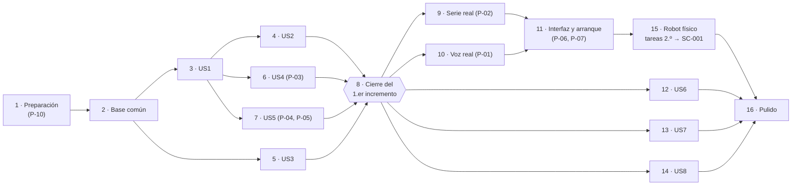

# Tareas: control por voz del Petoi Bittle (VOICE-BITTLE)

**Hito**: H2 · **Estado**: borrador para revisar con el equipo · **Fecha**: 26/10/2026

**Entrada**: [`spec.md`](spec.md) y [`plan.md`](plan.md) (commit `7b92170`).

**Requisitos previos**: `plan.md` (obligatorio), `spec.md` (historias de usuario). No existen `research.md`, `data-model.md` ni `contracts/`: su contenido está dentro de `plan.md` («Investigación previa», «Modelo de datos», «Contratos entre componentes»).

> **Cómo leer este documento.** Sigue la plantilla oficial de `tasks.md` de Spec Kit: fases, identificadores `T001…`, marca `[P]` para las tareas que se pueden hacer en paralelo y etiqueta `[US#]` para la historia de `spec.md` a la que pertenece la tarea. Las pruebas van **antes** que el código que las hace pasar (el enunciado pide pruebas reproducibles sin robot, REQ-26).
>
> Cada tarea dice:
>
> - **REQ**: los requisitos que cubre.
> - **Base**: la decisión (`D-NN`) o el pendiente (`P-NN`) de `plan.md` de la que depende.
> - **Resultado**: qué prueba pasa o qué se ve al terminar. Sin este resultado la tarea no está hecha.
>
> **BLOQUEADA por P-NN**: la tarea depende de una decisión pendiente. Se puede empezar con el valor propuesto en `plan.md`, pero **no se cierra** hasta que el equipo decida ese pendiente.
>
> No se ha inventado ningún valor. Los nombres de los ficheros de prueba son una propuesta dentro de la estructura de carpetas de `plan.md` (pendiente P-10).

## Formato: `[ID] [P?] [Historia] Descripción`

- **[P]**: se puede hacer en paralelo (ficheros distintos, sin dependencia de una tarea sin terminar).
- **[US#]**: historia de `spec.md` (US1 = Historia 1 … US8 = Historia 8). Las tareas de preparación, base, integración y robot físico no llevan etiqueta de historia.

## Rutas

Estructura propuesta en `plan.md` («Código fuente»), pendiente de confirmar (P-10):

- Código: `H3-implementacion-pruebas/src/atenio/`
- Datos: `H3-implementacion-pruebas/datos/`
- Pruebas: `H3-implementacion-pruebas/tests/unitarias/`, `tests/integracion/`, `tests/frases/`
- Ensayos con el robot físico: `H4-demostracion-aceptacion/ensayos-fisicos.md` y `H4-demostracion-aceptacion/evidencias/` (nombres de `H4-demostracion-aceptacion/README.md`)

En las tareas, `src/`, `datos/` y `tests/` quieren decir `H3-implementacion-pruebas/src/`, `H3-implementacion-pruebas/datos/` y `H3-implementacion-pruebas/tests/`.

## Incrementos

| Incremento | Fases | Qué entrega | Criterios de éxito |
|---|---|---|---|
| **Primer incremento** (propuesta de `plan.md`, pendiente de confirmar por el equipo) | 1 a 8 | Historias P1 (1 a 5) sobre la cadena **texto → intérprete → gestor → robot simulado**. Todas las pruebas pasan sin robot ni micrófono. | SC-002, SC-005, SC-006, SC-007, SC-009, SC-010, SC-011, SC-012 |
| **Segundo incremento** | 9 a 11 y las tareas de la fase 15 marcadas «2.º» | Enlace serie real (USB, luego Bluetooth), voz real (captura y transcripción), interfaz y arranque completo. Demostración con el robot físico. | SC-001; también SC-003, SC-004, SC-008 |
| **Después** | 12 a 14, las tareas de la fase 15 marcadas «P2/P3» y la fase 16 | Historias P2 (6, 7) y P3 (8). Pulido y revisión final. | Resto de REQ |

---

## Fase 1 · Preparación (primer incremento)

**Objetivo**: confirmar la base técnica y crear el proyecto vacío.

- [ ] T001 Revisar con el equipo y decidir P-10: lenguaje (D-01), estructura de carpetas, catálogo en fichero (D-05), reloj sustituible (D-08) y pruebas por texto (D-09). **REQ**: base de todos. **Base**: P-10. **Resultado**: decisión anotada por el equipo en `plan.md` («Decisiones pendientes»). *Esta tarea abre el resto: todas las demás dependen de ella.*
- [ ] T002 Crear las carpetas de `plan.md`: `src/atenio/` (con `enlace/` e `interfaz/`), `datos/`, `tests/unitarias/`, `tests/integracion/`, `tests/frases/`. **REQ**: REQ-26, REQ-27. **Base**: D-01. **Resultado**: `import atenio` funciona desde `H3-implementacion-pruebas/`. **BLOQUEADA por P-10**.
- [ ] T003 [P] Crear `H3-implementacion-pruebas/requirements.txt` (`pyserial`, `pytest`; sin motor de voz, que espera a P-01) y la configuración de `pytest`. **REQ**: REQ-20, REQ-26. **Base**: D-01, D-04, D-08. **Resultado**: `pytest` se ejecuta en `H3-implementacion-pruebas/` sin errores (0 pruebas). **BLOQUEADA por P-10**.
- [ ] T004 [P] Escribir `H3-implementacion-pruebas/casos-de-prueba.md` (paso de `H3-implementacion-pruebas/README.md`): un caso por REQ, a partir de la columna «Prueba» de `spec.md`, con nivel (unitario, integración, voz real, robot físico) y tarea de este documento. **REQ**: REQ-01 a REQ-35. **Base**: plan «Niveles de prueba». **Resultado**: los 35 REQ tienen al menos un caso.

---

## Fase 2 · Base común (bloquea todas las historias)

**Objetivo**: las piezas que usan todas las historias: ajustes, reloj, catálogo, eventos y el robot simulado.

**⚠️ Ninguna historia empieza hasta terminar esta fase.**

- [ ] T005 [P] Escribir `tests/unitarias/test_ajustes.py` y `src/atenio/ajustes.py`, que lee `datos/ajustes.json` con los valores provisionales de `plan.md`: 5 s (REQ-35), T demo/real (REQ-31), comando de reposo de la parada y de la inactividad (D-11), puerto y baudios (D-04), máximo de órdenes por frase y palabras de enlace (D-06). **REQ**: REQ-31, REQ-35 (OPEN-02). **Base**: D-05. **Resultado**: la prueba cambia un valor en un fichero de ajustes de prueba y el programa lo lee sin tocar el código. *Los valores finales se cierran en T031 (palabras de enlace y máximo), T039 y T063 (comando de reposo) y T046 (puerto y baudios).*
- [ ] T006 [P] Escribir `tests/unitarias/test_reloj.py` y `src/atenio/reloj.py` con un reloj real y un reloj simulado que solo avanza cuando la prueba lo pide. **REQ**: REQ-26, REQ-31, REQ-35. **Base**: D-08. **Resultado**: la prueba avanza 300 s el reloj simulado y termina en milisegundos.
- [ ] T007 [P] Escribir `src/atenio/enlace/base.py`: interfaz común del enlace (conectar, enviar una cadena, saber si está conectado, leer las líneas que llegan del robot). **REQ**: REQ-20, REQ-26. **Base**: D-03. **Resultado**: la serie real (T040) y el simulado (T008) cumplen la misma interfaz; la prueba de T008 lo comprueba.
- [ ] T008 Escribir `tests/unitarias/test_robot_simulado.py` y `src/atenio/enlace/simulado.py` (depende de T006 y T007): registra cada cadena recibida con su hora, puede simular «sin conexión» y puede enviar líneas como «Low power: 6.5V». **REQ**: REQ-20, REQ-25, REQ-26, REQ-33. **Base**: D-03. **Resultado**: la prueba envía `ksit` y lee en el registro exactamente `ksit` con su hora.
- [ ] T009 [P] Escribir `tests/unitarias/test_eventos.py` y `src/atenio/eventos.py`: tipos de evento hacia la interfaz (texto reconocido, orden interpretada, estado de conexión, aviso) y los textos de aviso de `spec.md` («no se ha entendido bien», orden no disponible, «robot no conectado», «parada de emergencia activa», batería baja). **REQ**: REQ-19 (parte de eventos). **Base**: D-07, D-14. **Resultado**: un receptor de prueba recibe los cuatro tipos de evento; ningún aviso usa el pitido `b`.
- [ ] T010 [P] Escribir `tests/unitarias/test_catalogo.py`, `src/atenio/catalogo.py` y `datos/catalogo.json` con las 10 órdenes del Nivel 1 (palabra de la tabla de `spec.md`, comando, duración estimada provisional y marca «interrumpe» solo en «para»). Sinónimos: solo los que apruebe el equipo (H1 §2.4). **REQ**: REQ-02 a REQ-11. **Base**: D-05. **Resultado**: la prueba lee 10 órdenes y cada una tiene el comando exacto de `spec.md` (`ksit`, `kup`, `kwkF`, `kwkL`, `kwkR`, `krest`, `d`, `khi`, `kbalance`, `ktrF`). *`khi` y `ktrF` siguen por confirmar en el robot (OPEN-03, T064).*
- [ ] T011 [P] Escribir las frases de prueba en texto en `tests/frases/`: `con_nombre.txt` (20 frases «Atenio, <orden del Nivel 1>»), `sin_nombre.txt` (20 órdenes sin «Atenio»), `sin_sentido.txt` (20 entradas), `fuera_catalogo.txt` (10 órdenes, entre ellas «Atenio, sígueme»), `encadenadas.txt` (frases de 2 y de 3 órdenes y «Atenio, camina y bailoteo y siéntate»). Las escribe o revisa el equipo. **REQ**: REQ-01, REQ-12, REQ-13, REQ-29. **Base**: D-09. **Resultado**: los ficheros tienen el número de frases que piden `spec.md` y SC-005; no hay audio en el repositorio.
- [ ] T012 Escribir `tests/conftest.py` (depende de T005 a T011): fixtures con robot simulado, reloj simulado, catálogo y ajustes de prueba, y un guardián que hace fallar cualquier prueba que intente abrir un puerto serie o el micrófono. **REQ**: REQ-26. **Base**: D-03, D-08, D-09. **Resultado**: una prueba de ejemplo que intenta abrir un puerto serie falla con un mensaje claro.

**Punto de control**: base lista; las historias pueden empezar (en paralelo si hay personas).

---

## Fase 3 · Historia 1: dar una orden y que el robot la ejecute (P1) 🎯 primer incremento

**Objetivo**: «Atenio, <orden>» llega al robot simulado como el comando de esa orden; sin «Atenio» no pasa nada.

**Prueba independiente**: cada orden del Nivel 1 dada como texto llega al robot simulado como el comando esperado (SC-002).

### Pruebas (se escriben primero y deben fallar)

- [ ] T013 [P] [US1] `tests/unitarias/test_interprete_activacion.py`: las 20 frases de `con_nombre.txt` dan una orden; las 20 de `sin_nombre.txt` dan `ignorada`; la normalización (minúsculas, sin tildes, H1 §2.4) da el mismo resultado para «Atenio, siéntate» y «atenio sientate». **REQ**: REQ-01, REQ-18. **Base**: D-09. **Resultado**: prueba en rojo antes de T016, en verde después.
- [ ] T014 [P] [US1] `tests/unitarias/test_interprete_espera.py` con reloj simulado: «Atenio» solo y una orden antes de 5 s → orden; después de 5 s → `ignorada`; «Atenio» solo sin nada más → ningún comando, y la siguiente orden con nombre se atiende. **REQ**: REQ-35. **Base**: D-08 (5 s provisional, OPEN-02). **Resultado**: prueba en rojo antes de T017, en verde después.
- [ ] T015 [P] [US1] `tests/integracion/test_nivel1.py`: para cada una de las 10 órdenes del Nivel 1, el texto «Atenio, <orden>» deja en el registro del robot simulado la cadena exacta del catálogo. **REQ**: REQ-02 a REQ-11, REQ-20. **Base**: D-03, D-05. **Resultado**: 10 casos en verde (SC-002).

### Implementación

- [ ] T016 [US1] `src/atenio/interprete.py`: normalizar el texto, detectar «Atenio», buscar la orden en el catálogo y devolver una Interpretación con los tipos de `plan.md` (`órdenes`, `ignorada`, `solo_activación`…). **REQ**: REQ-01, REQ-02 a REQ-11, REQ-18. **Base**: D-05, D-09. **Resultado**: T013 en verde.
- [ ] T017 [US1] `src/atenio/interprete.py`: espera de REQ-35 con el reloj sustituible y el valor de `ajustes.json`. **REQ**: REQ-35. **Base**: D-08. **Resultado**: T014 en verde.
- [ ] T018 [US1] `src/atenio/gestor_acciones.py`, versión mínima: en estado `Libre`, envía al enlace el comando de la orden y emite el evento «orden interpretada». **REQ**: REQ-02 a REQ-11, REQ-20. **Base**: D-03. **Resultado**: prueba unitaria `tests/unitarias/test_gestor_basico.py` en verde.
- [ ] T019 [US1] `src/atenio/principal.py`: función que monta la cadena intérprete → gestor → enlace con el enlace y el reloj que se le pasen (real o simulado). **REQ**: REQ-26. **Base**: D-03, D-08. **Resultado**: T015 en verde.
- [ ] T020 [US1] `tests/integracion/test_latencia_software.py`: 20 mediciones desde que el texto entra en el intérprete hasta que el robot simulado registra el comando, con reloj real. **REQ**: REQ-21 (parte propia, sin transcripción). **Base**: D-08. **Resultado**: las 20 mediciones < 1,5 s `[provisional]`. *La medida completa con voz es T050.*

**Punto de control**: la Historia 1 funciona y se prueba sola, sin robot ni micrófono.

---

## Fase 4 · Historia 2: entrada que no es una orden válida (P1) 🎯 primer incremento

**Objetivo**: el ruido, las frases sin sentido y las órdenes fuera del catálogo no mueven el robot y producen un aviso.

**Prueba independiente**: con el robot simulado, ninguna entrada inválida deja un comando en el registro y cada una produce su aviso.

### Pruebas

- [ ] T021 [P] [US2] `tests/unitarias/test_interprete_invalidas.py`: las 20 entradas de `sin_sentido.txt` dan `no_entendida` con el aviso «no se ha entendido bien»; las 10 de `fuera_catalogo.txt` dan `fuera_del_catálogo` con el aviso de orden no disponible. **REQ**: REQ-12, REQ-13. **Base**: D-14. **Resultado**: prueba en rojo antes de T024, en verde después.
- [ ] T022 [P] [US2] `tests/integracion/test_invalidas.py`: las 20 frases sin nombre, las 20 sin sentido y las 10 fuera del catálogo pasan por la cadena completa; el registro del robot simulado queda vacío y hay un evento de aviso por cada entrada que lo pide. **REQ**: REQ-01, REQ-12, REQ-13. **Base**: D-03, D-14. **Resultado**: en verde (SC-005).
- [ ] T023 [P] [US2] `tests/integracion/test_robustez.py`: 20 entradas inválidas seguidas y después «Atenio, siéntate». **REQ**: REQ-23. **Base**: D-09. **Resultado**: el robot simulado registra `ksit` solo al final (SC-006).

### Implementación

- [ ] T024 [US2] `src/atenio/interprete.py`: clasificar `no_entendida` y `fuera_del_catálogo` con sus avisos. **REQ**: REQ-12, REQ-13. **Base**: D-05, D-14. **Resultado**: T021 y T022 en verde. *El criterio para distinguir «sin sentido», «fuera del catálogo» e «ignorada» no está escrito; ver Discrepancias Y-02.*
- [ ] T025 [US2] `src/atenio/gestor_acciones.py`: con una Interpretación sin órdenes, no enviar nada y pasar los avisos como eventos (solo en pantalla). **REQ**: REQ-12, REQ-13, REQ-23. **Base**: D-14. **Resultado**: T022 y T023 en verde.

**Punto de control**: las Historias 1 y 2 funcionan juntas; con esto la lógica del criterio mínimo (SC-001) está probada sin robot.

---

## Fase 5 · Historia 3: probar el sistema sin el robot físico (P1) 🎯 primer incremento

**Objetivo**: todo el conjunto de pruebas corre sin robot ni micrófono y da siempre el mismo resultado.

**Prueba independiente**: ejecutar `pytest` dos veces en un portátil sin robot conectado.

- [ ] T026 [US3] `tests/integracion/test_sin_robot.py`: comprobar que ninguna prueba usa el enlace serie real ni el micrófono (el guardián de T012 está activo en todo el conjunto). **REQ**: REQ-26. **Base**: D-03, D-09. **Resultado**: en verde; si alguien añade una prueba que abre un puerto, falla.
- [ ] T027 [US3] Script `H3-implementacion-pruebas/ejecutar_pruebas.sh` (o el comando que fije el equipo) que ejecuta todo el conjunto dos veces y compara los resultados. **REQ**: REQ-26. **Base**: D-08. **Resultado**: las dos ejecuciones dan el mismo resultado, sin robot conectado (SC-007).

**Punto de control**: SC-007 cumplido para lo construido hasta aquí. Se repite en T041 al cerrar el incremento.

---

## Fase 6 · Historia 4: órdenes encadenadas y cola de acciones (P1) 🎯 primer incremento

**Objetivo**: varias órdenes en una frase, y órdenes dadas con el robot ocupado, llegan al robot en orden, cada una al terminar la anterior.

**Prueba independiente**: con robot y reloj simulados, frases de 2 y 3 órdenes, una frase con una orden fuera del catálogo y tres órdenes dadas con el robot ocupado.

### Pruebas

- [ ] T028 [P] [US4] `tests/unitarias/test_interprete_encadenadas.py`: las frases de `encadenadas.txt` dan las órdenes en el orden dicho; «Atenio, camina y bailoteo y siéntate» da [camina, siéntate] y un aviso por «bailoteo». **REQ**: REQ-29. **Base**: D-06. **Resultado**: en rojo antes de T031, en verde después. **BLOQUEADA por P-03** (palabras de enlace y máximo de órdenes por frase).
- [ ] T029 [P] [US4] `tests/unitarias/test_gestor_cola.py` con reloj simulado: tres órdenes dadas con el robot ocupado; ningún comando sale antes de que pase la duración estimada del anterior y salen en el orden de llegada. **REQ**: REQ-32. **Base**: D-06, D-08. **Resultado**: en rojo antes de T032, en verde después (SC-010). **BLOQUEADA por P-03** (fin de acción por duración).
- [ ] T030 [P] [US4] `tests/integracion/test_encadenadas.py`: frases de 2 y 3 órdenes por la cadena completa; el registro del robot simulado tiene los comandos en el orden dicho y la orden fuera del catálogo se salta con aviso. **REQ**: REQ-29. **Base**: D-06. **Resultado**: en verde (SC-009). **BLOQUEADA por P-03**.

### Implementación

- [ ] T031 [US4] `src/atenio/interprete.py`: partir la frase por las palabras de enlace de `ajustes.json` («y», «luego» como valor inicial), aplicar el máximo de órdenes por frase y saltar con aviso las que no están en el catálogo. **REQ**: REQ-29. **Base**: D-06. **Resultado**: T028 en verde. **BLOQUEADA por P-03**.
- [ ] T032 [US4] `src/atenio/gestor_acciones.py`: cola de pasos en orden de llegada, estado `Ocupado`, fin de acción cuando pasa la duración estimada del catálogo, y envío del siguiente paso. **REQ**: REQ-29, REQ-32. **Base**: D-06, D-08. **Resultado**: T029 y T030 en verde. **BLOQUEADA por P-03**.
- [ ] T033 [US4] `datos/catalogo.json`: poner las duraciones medidas de cada comando del Nivel 1 y el tiempo de marcha de `kwkF`, `kwkL`, `kwkR` y `ktrF` (depende de T069). **REQ**: REQ-04 a REQ-06, REQ-11, REQ-29, REQ-32. **Base**: D-06. **Resultado**: el catálogo no tiene ninguna duración marcada como provisional; T029 y T030 siguen en verde. **BLOQUEADA por P-03**. *Mientras tanto, el primer incremento usa las duraciones provisionales (riesgo R-03, R-04).*

**Punto de control**: las Historias 1 a 4 funcionan juntas con el robot simulado.

---

## Fase 7 · Historia 5: «para» y parada de emergencia (P1) 🎯 primer incremento

**Objetivo**: «Atenio, para» interrumpe siempre; el botón de parada deja el robot en reposo, vacía la cola y bloquea las órdenes hasta volver a pulsarlo.

**Prueba independiente**: con el robot simulado ocupado, decir «Atenio, para»; activar la parada, dar órdenes válidas y comprobar que no sale nada; desactivarla y comprobar que la siguiente se ejecuta.

### Pruebas

- [ ] T034 [P] [US5] `tests/unitarias/test_gestor_para.py` con reloj simulado: con una acción en curso y órdenes en la cola, «Atenio, para» hace que el simulado registre `krest` en el momento, y «para» nunca entra en la cola. **REQ**: REQ-07, REQ-32. **Base**: D-10. **Resultado**: en rojo antes de T037, en verde después (SC-012).
- [ ] T035 [P] [US5] `tests/unitarias/test_gestor_para_cola.py`: tras «para», la cola queda vacía; en «Atenio, camina y para» se descarta lo que queda de la frase. **REQ**: REQ-07, REQ-29, REQ-32. **Base**: D-10. **Resultado**: en rojo antes de T038, en verde después. **BLOQUEADA por P-04** (OPEN-12).
- [ ] T036 [P] [US5] `tests/unitarias/test_gestor_parada.py`: al activar la parada, el simulado registra el comando de reposo de `ajustes.json` y la cola queda vacía; 10 órdenes válidas no producen ningún comando y cada una produce el aviso «parada de emergencia activa»; al desactivar, la siguiente orden válida se ejecuta. **REQ**: REQ-30. **Base**: D-11. **Resultado**: en rojo antes de T039, en verde después (SC-011). **BLOQUEADA por P-05** (solo el valor del comando de reposo).

### Implementación

- [ ] T037 [US5] `src/atenio/gestor_acciones.py`: una orden con la marca «interrumpe» del catálogo se envía aunque el robot esté ocupado y no se encola. **REQ**: REQ-07. **Base**: D-05, D-10. **Resultado**: T034 en verde.
- [ ] T038 [US5] `src/atenio/gestor_acciones.py` e `interprete.py`: «para» vacía la cola y descarta el resto de una frase encadenada, según lo que decida el equipo (opción A, B o C de D-10, como ajuste). **REQ**: REQ-07, REQ-29, REQ-32. **Base**: D-10. **Resultado**: T035 en verde con la opción elegida. **BLOQUEADA por P-04**.
- [ ] T039 [US5] `src/atenio/gestor_acciones.py`: estado `Parada` con una función `pulsar_parada()` que lo activa y lo desactiva (la interfaz la conecta en T053). Comando de reposo leído de `ajustes.json` (`d` propuesto para la parada). **REQ**: REQ-30. **Base**: D-11. **Resultado**: T036 en verde. **BLOQUEADA por P-05**.
- [ ] T040 [US5] `tests/integracion/test_parada_y_para.py`: las mismas comprobaciones de T034 y T036 por la cadena completa, entrando por texto. **REQ**: REQ-07, REQ-30, REQ-32. **Base**: D-10, D-11. **Resultado**: en verde (SC-011, SC-012).

**Punto de control**: las cinco historias P1 funcionan con el robot simulado.

---

## Fase 8 · Cierre y verificación del primer incremento 🎯

**Objetivo**: comprobar que el primer incremento cumple sus criterios de éxito y entregarlo (CLAUDE.md: «Entrega el primer incremento identificado en `tasks.md`»).

- [ ] T041 Ejecutar todo el conjunto con T027 sin robot ni micrófono y anotar en `H3-implementacion-pruebas/casos-de-prueba.md` el resultado de cada caso del incremento. **REQ**: REQ-01 a REQ-13, REQ-20, REQ-23, REQ-26, REQ-29, REQ-30, REQ-32, REQ-35. **Base**: D-08, D-09. **Resultado**: en verde SC-002, SC-005, SC-006, SC-007, SC-009, SC-010, SC-011 y SC-012; las tareas BLOQUEADAS que sigan abiertas se listan aparte.
- [ ] T042 Revisión del código del primer incremento por el equipo → `H3-implementacion-pruebas/revision-codigo.md` (paso de `H3-implementacion-pruebas/README.md`). **REQ**: REQ-18 (el intérprete es código propio), REQ-24 (no hay escritura de audio). **Base**: D-09. **Resultado**: el fichero lista lo revisado y los cambios pedidos; los cambios están hechos.

**Punto de control: PRIMER INCREMENTO TERMINADO.** Se puede demostrar con frases escritas y el robot simulado.

---

## Fase 9 · Enlace serie real (segundo incremento)

**Objetivo**: enviar los mismos comandos al robot real por un puerto serie (primero USB, después Bluetooth).

- [ ] T043 [P] `tests/unitarias/test_enlace_serie.py` con un puerto serie falso (sustituye a `pyserial` en la prueba): `serie.py` abre el puerto y los baudios de `ajustes.json` y escribe la cadena del catálogo sin cambiarla. **REQ**: REQ-20. **Base**: D-03, D-04. **Resultado**: en verde sin robot.
- [ ] T044 `src/atenio/enlace/serie.py` con `pyserial`: cumple la interfaz de `enlace/base.py`, envía en el formato del protocolo serie de Petoi (`capacidades-bittle.md`) y lee las líneas que devuelve el robot. **REQ**: REQ-20. **Base**: D-03, D-04. **Resultado**: T043 en verde; con el robot, T072. **BLOQUEADA por P-02** (puerto, baudios, USB o Bluetooth).
- [ ] T045 [P] Elegir enlace real o simulado con un ajuste en `src/atenio/principal.py`. **REQ**: REQ-26, REQ-27. **Base**: D-03. **Resultado**: el mismo programa arranca con el simulado (pruebas) o con la serie (robot) cambiando solo `ajustes.json`.
- [ ] T046 Poner en `datos/ajustes.json` el puerto y los baudios medidos en T070 (depende de T070). **REQ**: REQ-20. **Base**: D-04. **Resultado**: el programa se conecta al robot por USB y, si el emparejamiento funciona, por Bluetooth. **BLOQUEADA por P-02**.

---

## Fase 10 · Voz real: captura y transcripción (segundo incremento)

**Objetivo**: pasar de la voz del micrófono a texto, en local y sin dejar audio en el disco.

- [ ] T047 Prototipo I-1 de `plan.md`: Vosk y Faster-Whisper en el portátil, 20 frases por motor; medir latencia, aciertos y si reconoce «Atenio». Resultado escrito en `H3-implementacion-pruebas/prototipos/motor-voz.md` (ruta propuesta). **REQ**: REQ-01, REQ-21, REQ-22 (OPEN-01). **Base**: D-02. **Resultado**: tabla de medidas por motor y una propuesta de motor para que el equipo cierre P-01. *Esta tarea es la que resuelve P-01.*
- [ ] T048 [P] Prototipo I-2 de `plan.md`: comprobar en la documentación del motor y en la carpeta de trabajo que el audio se procesa en local y no se guarda. Resultado en el mismo fichero que T047. **REQ**: REQ-24 (OPEN-06). **Base**: D-02. **Resultado**: tras una sesión de prueba no hay ficheros de audio nuevos en el disco.
- [ ] T049 [P] `tests/unitarias/test_transcripcion.py` y `tests/unitarias/test_sin_audio_en_disco.py` con un motor falso: el adaptador devuelve texto o «vacío», y después de procesar audio no aparece ningún fichero nuevo en una carpeta temporal vigilada. **REQ**: REQ-18, REQ-24. **Base**: D-02, D-09. **Resultado**: en verde sin micrófono (parte automática de SC-008).
- [ ] T050 `src/atenio/transcripcion.py`: adaptador «audio → texto» delante del motor elegido. Añadir el motor a `requirements.txt`. **REQ**: REQ-18, REQ-21. **Base**: D-02. **Resultado**: T049 en verde con el motor falso; con el motor real, una frase dicha aparece como texto. **BLOQUEADA por P-01**.
- [ ] T051 `src/atenio/audio.py`: leer el micrófono y pasar bloques de audio en memoria al adaptador, sin escribir en el disco. **REQ**: REQ-17, REQ-24. **Base**: D-02. **Resultado**: una frase dicha ante el micrófono llega al adaptador; T049 sigue en verde. **BLOQUEADA por P-01** (la biblioteca de audio se elige con el motor).
- [ ] T052 Medida de latencia con voz real y robot simulado: 20 mediciones desde el final de la frase hasta el registro del comando. Cómo se marca el final de la frase depende del motor (plan, «Medida de la latencia»). **REQ**: REQ-21. **Base**: D-02, D-08. **Resultado**: las 20 < 1,5 s `[provisional]`, anotadas en `casos-de-prueba.md` (SC-004). **BLOQUEADA por P-01**.
- [ ] T053 Tasa de aciertos con voz real y robot simulado: 20 intentos por cada orden del Nivel 1 en una sala tranquila. **REQ**: REQ-22. **Base**: D-02. **Resultado**: ≥ 80 % `[provisional]` de órdenes correctas, anotado en `casos-de-prueba.md` (SC-003). **BLOQUEADA por P-01**.
- [ ] T054 [P] Inspección tras una sesión con voz real: no queda ningún fichero de audio en el disco. **REQ**: REQ-24. **Base**: D-02. **Resultado**: lista de la carpeta de trabajo y de la carpeta temporal sin audio, anotada en `casos-de-prueba.md` (SC-008). **BLOQUEADA por P-01**.

---

## Fase 11 · Interfaz y arranque completo (segundo incremento)

**Objetivo**: el usuario ve qué ha pasado y tiene el botón de parada; el programa entero arranca en el portátil del equipo.

- [ ] T055 [P] `tests/integracion/test_eventos_interfaz.py`: para una frase válida y una inválida, un receptor de eventos (en lugar de la interfaz) recibe el texto reconocido, la orden interpretada, el estado de la conexión y el aviso. **REQ**: REQ-19. **Base**: D-07. **Resultado**: en verde sin abrir la interfaz.
- [ ] T056 `src/atenio/interfaz/`: muestra el texto reconocido, la orden interpretada, el estado de la conexión y los avisos (solo en pantalla), y tiene el botón de parada conectado a `pulsar_parada()` (T039). **REQ**: REQ-19, REQ-30. **Base**: D-07, D-14. **Resultado**: en una sesión con el robot simulado se ven los cuatro elementos y el botón activa y desactiva la parada. **BLOQUEADA por P-06** (web o escritorio, y marco).
- [ ] T057 `src/atenio/principal.py`: arranque completo micrófono → transcripción → intérprete → gestor → enlace (real o simulado) → interfaz. **REQ**: REQ-17 a REQ-20, REQ-27. **Base**: D-01, D-03. **Resultado**: con el robot simulado, una orden dicha aparece en la interfaz y en el registro del simulado. **BLOQUEADA por P-07** («otro ordenador»: si son dos ordenadores, hace falta una interfaz de red).
- [ ] T058 Sección «Cómo instalar y ejecutar» en `H3-implementacion-pruebas/README.md`. **REQ**: REQ-27. **Base**: D-01. **Resultado**: una persona del equipo que no ha escrito el código instala y arranca el programa en el portátil del equipo siguiendo solo esa sección. **BLOQUEADA por P-07**.

**Punto de control**: con el robot simulado, la cadena completa con voz funciona. Falta el robot físico (fase 15, tareas «2.º»).

---

## Fase 12 · Historia 6: estado del sistema y de la conexión (P2)

**Objetivo**: sin conexión no sale ningún comando y el usuario lo ve.

**Prueba independiente**: con el robot simulado en «sin conexión», dar una orden.

- [ ] T059 [P] [US6] `tests/unitarias/test_gestor_sin_conexion.py`: con el simulado desconectado, una orden válida no deja nada en el registro y produce el aviso «robot no conectado». **REQ**: REQ-25. **Base**: D-13 (parte fijada). **Resultado**: en rojo antes de T060, en verde después.
- [ ] T060 [US6] `src/atenio/gestor_acciones.py`: no enviar si el enlace no está conectado; emitir el estado de conexión como evento. **REQ**: REQ-19, REQ-25. **Base**: D-13. **Resultado**: T059 en verde; la interfaz (T056) muestra «robot no conectado».
- [ ] T061 [US6] `tests/unitarias/test_gestor_perdida_conexion.py` y su código en `gestor_acciones.py`: si falla un envío durante una acción, marcar «desconectado», vaciar la cola y avisar. **REQ**: REQ-25. **Base**: D-13. **Resultado**: prueba en verde con el simulado que falla a mitad de una cola. **BLOQUEADA por P-08**.

---

## Fase 13 · Historia 7: reposo, batería baja y manipulación (P2)

**Objetivo**: reposo tras T, aviso de batería baja y giroscopio sin tocar.

**Prueba independiente**: con robot y reloj simulados, T reducido y el simulado enviando «Low power».

- [ ] T062 [P] [US7] `tests/unitarias/test_gestor_inactividad.py` con reloj simulado: al pasar T sin órdenes, el simulado registra el comando de reposo por inactividad; una orden válida después sale del reposo y se ejecuta; con la parada activa, una orden no despierta al robot. **REQ**: REQ-30, REQ-31. **Base**: D-08, D-11. **Resultado**: en rojo antes de T063, en verde después. **BLOQUEADA por P-05**.
- [ ] T063 [US7] `src/atenio/gestor_acciones.py`: estado `Reposo` con T de `ajustes.json` (5 min demo, 15 min uso real) y la prioridad de la parada sobre el reposo. **REQ**: REQ-31. **Base**: D-08, D-11. **Resultado**: T062 en verde. **BLOQUEADA por P-05** (`krest` propuesto para la inactividad).
- [ ] T064 [P] [US7] `tests/integracion/test_bateria_baja.py` y su código en `enlace/` y `gestor_acciones.py`: el simulado envía «Low power: 6.5V» y aparece el evento de aviso de batería baja. **REQ**: REQ-33. **Base**: D-03. **Resultado**: en verde sin robot.
- [ ] T065 [P] [US7] `tests/unitarias/test_sin_giroscopio.py`: ningún comando del catálogo ni de los ajustes es el token `G` o `g`, y el enlace no los envía en ninguna prueba. **REQ**: REQ-34. **Base**: D-12. **Resultado**: en verde. *D-12 no tiene pendiente P-NN; ver Discrepancias Y-01.*


---

## Fase 14 · Historia 8: órdenes extra opcionales (P3)

**Objetivo**: «baila», «media vuelta» y «da una vuelta», solo si hay tiempo.

**Prueba independiente**: con el robot simulado, la lista de comandos enviada coincide con la definida para cada orden.

- [ ] T066 [P] [US8] `tests/integracion/test_opcionales.py` con reloj simulado: cada orden opcional es una sola entrada y produce su lista de comandos en orden; funciona también dentro de la cola. **REQ**: REQ-14, REQ-15, REQ-16. **Base**: D-05, D-06. **Resultado**: en rojo antes de T067, en verde después. **BLOQUEADA por P-09**.
- [ ] T067 [US8] `datos/catalogo.json`: secuencia de «baila» y, para «media vuelta» y «da una vuelta», `kwkL` durante la duración medida y el comando que corta el giro. **REQ**: REQ-14, REQ-15, REQ-16. **Base**: D-05, D-06. **Resultado**: T066 en verde con los valores medidos en T080. **BLOQUEADA por P-09** (y P-03 para el tiempo de marcha).

---

## Fase 15 · Pruebas manuales con el robot físico (H4)

**Objetivo**: comprobar en el robot lo que no se puede probar sin él, y resolver los pendientes que necesitan medidas (sesión 2 de `plan.md`, I-3 a I-5).

**Regla**: toda sesión con el robot empieza con T068. Los resultados se anotan en `H4-demostracion-aceptacion/ensayos-fisicos.md`; las pruebas de la demo, en `H4-demostracion-aceptacion/evidencias/` (sin audios personales, CLAUDE.md).

| ID | Inc. | Tarea | REQ | Base | Resultado comprobable |
|---|---|---|---|---|---|
| T068 | 2.º | Lista de comprobación de seguridad antes de cada sesión: superficie lisa y una persona vigilando. | REQ-28 | — (restricción externa) | Lista firmada al principio de cada sesión en `ensayos-fisicos.md`. |
| T069 | 2.º | Sesión 2 · I-4: enviar cada comando del Nivel 1 y anotar cuánto dura y qué devuelve el robot por el puerto. Puede hacerse antes de T044 con las herramientas de Petoi. | REQ-02 a REQ-11, REQ-29, REQ-32 | D-06, CTX-05 | Tabla comando → duración → respuesta. Permite cerrar **P-03** y T033. |
| T070 | 2.º | Sesión 2 · I-3: conectar por USB y por Bluetooth; anotar puerto, baudios y si el emparejamiento funciona. | REQ-20 | D-04 | Puerto y baudios comprobados. Permite cerrar **P-02**, T046 y la discrepancia X-02 de `plan.md`. |
| T071 | 2.º | Sesión 2 · I-5: probar `khi`, `ktrF`, `krest` y `d` (reposo), y si `lifted`/`dropped` paran el robot. | REQ-09, REQ-11, REQ-30, REQ-31, REQ-34 | D-11, D-12 | Resultado por comando. Permite cerrar OPEN-03, **P-05** y OPEN-10. Si `khi` o `ktrF` no existen, se cambia `datos/catalogo.json` (D-05). |
| T072 | 2.º | Cada orden del Nivel 1 con el programa completo (T057) y el robot real. **BLOQUEADA por P-02**. | REQ-02 a REQ-11, REQ-20 | D-03, D-04 | El robot hace el movimiento de la tabla de `spec.md` en cada una de las 10 órdenes. |
| T073 | 2.º | Parada de emergencia con el robot real: pulsar durante una acción, dar órdenes, volver a pulsar. **BLOQUEADA por P-05**. | REQ-30 | D-11 | El robot queda en reposo, ninguna orden lo mueve, y vuelve a obedecer tras la segunda pulsación. |
| T074 | 2.º | Ensayo general de la demo (SC-001): con voz real, interfaz y robot real, dos órdenes válidas y una entrada no reconocida. **BLOQUEADA por P-01, P-02, P-06, P-07**. | REQ-01, REQ-12, REQ-17 a REQ-20, REQ-27 | D-02, D-04, D-07 | El robot ejecuta las dos órdenes; con la entrada no reconocida no se mueve y la interfaz muestra el aviso. Evidencia en `evidencias/`. |
| T075 | 2.º | Encadenadas y cola con el robot real. **BLOQUEADA por P-03**. | REQ-29, REQ-32 | D-06 | Las acciones salen seguidas y en orden, sin que se pisen. |
| T076 | P2 | Desconectar el robot y dar una orden. | REQ-25 | D-13 | Ningún movimiento al reconectar sin orden nueva y aviso «robot no conectado» en la interfaz. |
| T077 | P2 | Reposo por inactividad con T = 5 min. **BLOQUEADA por P-05**. | REQ-31 | D-11 | A los 5 min el robot queda en reposo; una orden válida lo despierta y se ejecuta. |
| T078 | P2 | Batería baja: observar si el robot envía «Low power» al bajar la batería. | REQ-33 | D-03 | Si llega, la interfaz muestra el aviso; si no llega, se anota (OPEN-10). |
| T079 | P2 | Levantar el robot durante una acción. | REQ-34 | D-12 | El robot se detiene y se queda quieto (OPEN-10). |
| T080 | P3 | Sesión 2: medir la secuencia de «baila» y la duración del giro de «media vuelta» y «da una vuelta», y qué comando corta el giro. | REQ-14, REQ-15, REQ-16 | D-05, D-06 | Valores anotados. Permite cerrar **P-09** y T067. |
| T081 | P3 | Órdenes opcionales con el robot real: 5 intentos de cada giro con medida del ángulo; «baila» sin caída. **BLOQUEADA por P-09**. | REQ-14, REQ-15, REQ-16 | D-05, D-06 | Desviación ≤ ±45° `[provisional]` en los giros; «baila» termina en postura estable. |

---

## Fase 16 · Pulido y cierre

- [ ] T082 Revisión final del código → actualizar `H3-implementacion-pruebas/revision-codigo.md`. **REQ**: REQ-18, REQ-24. **Base**: D-09. **Resultado**: no hay cambios pedidos sin hacer.
- [ ] T083 Actualizar `H3-implementacion-pruebas/casos-de-prueba.md` con el resultado de cada caso (automático y manual) y la tarea que lo cubre. **REQ**: REQ-01 a REQ-35. **Base**: plan «Niveles de prueba». **Resultado**: cada REQ tiene un resultado o una razón escrita por la que no lo tiene.
- [ ] T084 Analyze (`/speckit.analyze`) de `spec.md`, `plan.md` y este documento → `H2-especificacion-planificacion/coherencia.md` (paso del `README.md` de H2). **REQ**: todos. **Base**: —. **Resultado**: lista de contradicciones y huecos revisada por el equipo.

---

## Dependencias y orden de ejecución

### Entre fases



- **Fase 1**: empieza ya. T001 abre todo lo demás (P-10).
- **Fase 2**: depende de la fase 1. Bloquea todas las historias.
- **Fases 3 a 7 (P1)**: dependen de la fase 2. US1 va primero porque crea el intérprete, el gestor mínimo y `principal.py` que usan las demás. Después, US2, US3, US4 y US5 se pueden repartir entre personas.
- **Fase 8**: cierra el primer incremento cuando las fases 3 a 7 están en verde.
- **Fases 9 a 11 (segundo incremento)**: siguen el orden de `plan.md` (serie real, voz, interfaz). Las fases 9 y 10 se pueden hacer a la vez.
- **Fase 15**: T068, T069, T070, T071 y T080 (sesión 2) **no dependen del código**: se pueden hacer en cuanto haya una sesión con el robot, y conviene hacerlas pronto porque cierran P-02, P-03, P-05 y P-09. Las demás tareas físicas dependen de T057.
- **Fases 12 a 14 (P2, P3)**: dependen de la fase 8. Sus tareas físicas (T076 a T079 y T081) van después.

### Dentro de cada historia

- Las pruebas se escriben primero y fallan; después el código las pone en verde.
- Datos (catálogo, ajustes) antes que el intérprete; intérprete antes que el gestor; gestor antes que la cadena completa.
- Una historia está terminada cuando su prueba independiente pasa sin robot.

### Tareas que resuelven pendientes

| Pendiente | Tarea que aporta la información | Tareas BLOQUEADAS por él |
|---|---|---|
| P-01 motor de voz | T047, T048 | T050, T051, T052, T053, T054, T074 |
| P-02 USB o Bluetooth, puerto, baudios | T070 | T044, T046, T072, T074 |
| P-03 fin de acción, máximo por frase, palabras de enlace | T069 | T028 a T033, T067, T075 |
| P-04 «para» y la cola | (decisión del equipo sobre D-10) | T035, T038 |
| P-05 comando de reposo | T071 | T036, T039, T062, T063, T073, T077 |
| P-06 interfaz web o escritorio | (decisión del equipo sobre D-07) | T056, T074 |
| P-07 «otro ordenador» | (el equipo o el cliente por Teams) | T057, T058, T074 |
| P-08 pérdida de conexión durante una acción | (decisión del equipo sobre D-13) | T061 |
| P-09 «baila» y giros | T080 | T066, T067, T081 |
| P-10 lenguaje, estructura, catálogo, reloj, pruebas por texto | T001 | T002, T003 y, a través de ellas, todas las demás |

### Oportunidades de trabajo en paralelo

- Fase 1: T003 y T004.
- Fase 2: T005, T006, T007, T009, T010 y T011 a la vez; T008 tras T006 y T007; T012 al final.
- Dentro de cada historia: las pruebas marcadas `[P]`.
- Tras US1: una persona por historia (US2, US3, US4, US5).
- Segundo incremento: fase 9 (serie) y fase 10 (voz) a la vez; sesión 2 con el robot en cualquier momento.

### Ejemplo: arrancar la Historia 1 en paralelo

```text
Persona A: T013 tests/unitarias/test_interprete_activacion.py
Persona B: T014 tests/unitarias/test_interprete_espera.py
Persona C: T015 tests/integracion/test_nivel1.py
Después:   T016 → T017 → T018 → T019 → T020
```

---

## Estrategia de implementación

### Primer incremento primero

1. Fase 1 (decidir P-10) y fase 2 (base común).
2. Fase 3 (US1). **Parar y comprobar**: las 10 órdenes llegan al robot simulado.
3. Fases 4 a 7 (US2 a US5), con las tareas BLOQUEADAS empezadas con los valores propuestos de `plan.md`.
4. Fase 8: SC-002, SC-005, SC-006, SC-007 y SC-009 a SC-012 en verde sin robot ni micrófono. **Entregar el primer incremento.**

### Entrega por incrementos

1. Primer incremento: cadena de texto con el robot simulado (arriba).
2. Segundo incremento: serie real (USB, luego Bluetooth) → voz real → interfaz → ensayo de la demo (T074, SC-001).
3. Después: US6 y US7 (P2), US8 (P3) si hay tiempo (riesgo R-09).

Cada incremento añade valor sin romper las pruebas del anterior: el conjunto de T027 se ejecuta de nuevo al final de cada fase.

### Con varias personas

1. Todo el equipo: fases 1 y 2.
2. Una persona hace US1; cuando termina, otras toman US2, US3, US4 y US5.
3. En el segundo incremento: una persona en la serie real y la sesión 2, otra en el prototipo de voz, otra en la interfaz.

---

## Trazabilidad REQ → tareas

| REQ | Tareas de implementación | Tareas de verificación (sin robot) | Tareas con voz real o robot físico (H4) |
|---|---|---|---|
| REQ-01 | T016 | T011, T013, T022 | T047, T074 |
| REQ-02 | T010, T016, T018 | T015 | T069, T072 |
| REQ-03 | T010, T016, T018 | T015 | T069, T072 |
| REQ-04 | T010, T016, T018, T033 | T015 | T069, T072 |
| REQ-05 | T010, T016, T018, T033 | T015 | T069, T072 |
| REQ-06 | T010, T016, T018, T033 | T015 | T069, T072 |
| REQ-07 | T010, T037, T038 | T034, T035, T040 | T069, T072 |
| REQ-08 | T010, T016, T018 | T015 | T069, T072 |
| REQ-09 | T010, T016, T018 | T015 | T069, T071, T072 |
| REQ-10 | T010, T016, T018 | T015 | T069, T072 |
| REQ-11 | T010, T016, T018, T033 | T015 | T069, T071, T072 |
| REQ-12 | T024, T025 | T011, T021, T022 | T074 |
| REQ-13 | T024, T025 | T011, T021, T022 | — |
| REQ-14 | T067 | T066 | T080, T081 |
| REQ-15 | T067 | T066 | T080, T081 |
| REQ-16 | T067 | T066 | T080, T081 |
| REQ-17 | T051, T057 | — | T074 |
| REQ-18 | T016, T050 | T013, T049, T042 | T074 |
| REQ-19 | T009, T056, T060 | T055 | T074 |
| REQ-20 | T007, T008, T018, T044, T046 | T015, T043 | T070, T072, T074 |
| REQ-21 | T050 | T020 | T047, T052 |
| REQ-22 | T050 | — | T047, T053 |
| REQ-23 | T025 | T023 | — |
| REQ-24 | T051 | T049, T042 | T048, T054 |
| REQ-25 | T060, T061 | T008, T059, T061 | T076 |
| REQ-26 | T007, T008, T012, T019, T045 | T026, T027, T041 | — |
| REQ-27 | T002, T045, T057, T058 | — | T074 |
| REQ-28 | — (restricción externa) | — | T068 |
| REQ-29 | T031, T032, T033, T038 | T011, T028, T030, T035 | T075 |
| REQ-30 | T039, T056 | T036, T040, T062 | T071, T073 |
| REQ-31 | T005, T063 | T062 | T071, T077 |
| REQ-32 | T032, T033, T037 | T029, T034, T035, T040 | T069, T075 |
| REQ-33 | T064 | T064 | T078 |
| REQ-34 | (D-12: no enviar `G`/`g`) | T065 | T071, T079 |
| REQ-35 | T017 | T014 | — |

**REQ sin tarea**: ninguno. Los 35 REQ (REQ-01 a REQ-35) tienen al menos una tarea. Casos con cobertura limitada:

- **REQ-28** solo se verifica por inspección (T068): es una restricción externa, no un comportamiento del programa.
- **REQ-34** no tiene código propio: la decisión D-12 es no enviar nunca `G`/`g` (T065). El comportamiento real solo se ve con el robot (T079, OPEN-10).
- **REQ-13, REQ-23 y REQ-35** no tienen prueba con el robot físico: `spec.md` solo pide prueba sin robot.

---

## Discrepancias detectadas

No se ha editado `spec.md`, `plan.md` ni H1. El equipo decide cómo corregirlas.

| # | Dónde | Qué pasa |
|---|---|---|
| Y-01 | `plan.md` D-12 frente a «Decisiones pendientes» | D-12 está «Propuesta, pendiente de confirmar por el equipo», pero ningún P-NN la recoge (P-10 cita D-01, D-05, D-08 y D-09). T065 no se ha marcado BLOQUEADA por falta de P-NN. |
| Y-02 | `spec.md` REQ-01 y REQ-12 frente al contrato del intérprete en `plan.md` | REQ-12 pide el aviso «no se ha entendido bien» ante ruido o frases sin sentido; el contrato del plan dice «Sin "Atenio" → `ignorada`» (sin aviso, por REQ-01). Ruido sin «Atenio» cae en los dos. Tampoco está escrito el criterio para distinguir «sin sentido» (REQ-12) de «fuera del catálogo» (REQ-13). Afecta a T021, T022 y T024. |
| Y-03 | `spec.md` REQ-30 frente a `plan.md` D-11 | REQ-30 dice «modo reposo», y D-11 propone `d` para la parada, que en REQ-08 es «tumbarse y apagar los motores», no reposo (`krest`). Si el equipo elige `d`, conviene ajustar la redacción de REQ-30 (o la de REQ-08). |
| Y-04 | `spec.md` REQ-12 frente a REQ-13 | REQ-12 dice «ningún comando **de movimiento**»; REQ-13 dice «ningún comando». Las pruebas (T022) comprueban que no sale ningún comando en los dos casos; si REQ-12 permite comandos que no son de movimiento, hay que decir cuáles. |
| Y-05 | `plan.md` «Estructura del proyecto» | No hay sitio para los resultados de los prototipos I-1 e I-2. Este documento propone `H3-implementacion-pruebas/prototipos/motor-voz.md` (T047). |
| Y-06 | `spec.md` Historia 7 y `plan.md` «Niveles de prueba» | La spec prueba la batería baja solo con el simulado (REQ-33); el plan pone «batería baja» también en el nivel de robot físico. T078 la incluye como observación, sin criterio de aceptación propio. |
