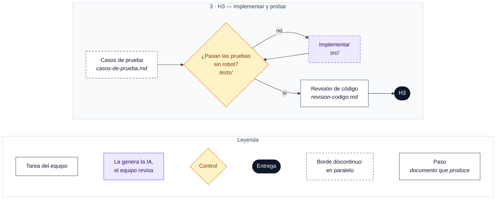

# H3 · Implementación y pruebas

**Entregable:** código ejecutable y pruebas en el repositorio.

**Mínimo exigido:** implementación generada con apoyo de IA, revisión del código y **pruebas reproducibles sin necesidad del robot físico**.

## Flujo de trabajo

Cada caja indica en cursiva el documento que produce. Leyenda debajo del diagrama.

### Pasos

**A la vez:**
- [ ] Diseñar los casos de prueba → `casos-de-prueba.md`
- [ ] Implementar el primer incremento con IA (`/speckit.implement`) → `src/`

**Después:**
- [ ] Pruebas reproducibles sin el robot → `tests/`. Si fallan, se vuelve a implementar.
- [ ] Revisión del código → `revision-codigo.md`

> La ubicación exacta de `src/` y `tests/` se fija en `plan.md`.

> El detalle de este hito se completará cuando se presente en clase.
