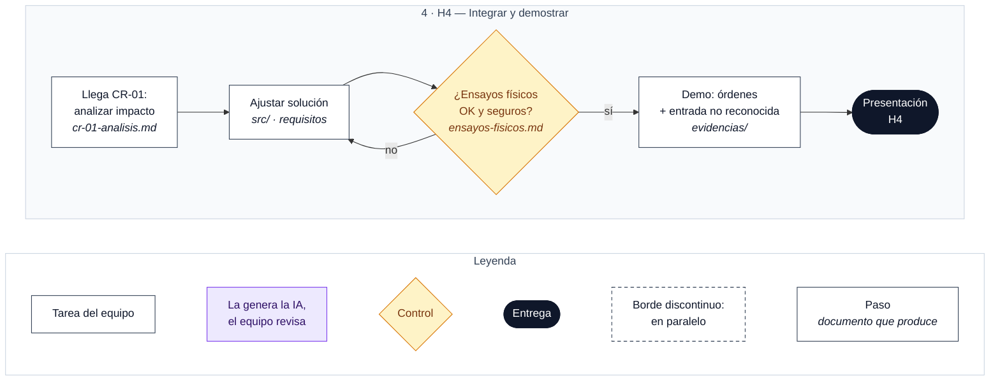

# H4 · Demostración y aceptación

**Entregable:** sistema integrado y evidencias de funcionamiento.

**Mínimo exigido:**
- Demostración de las **dos órdenes válidas** y del tratamiento de una **entrada no reconocida**.
- Pruebas físicas observadas.
- Respuesta a la **solicitud de cambio CR-01**.
- Resultados documentados.

## Flujo de trabajo

Cada caja indica en cursiva el documento que produce. Leyenda debajo del diagrama.

### Pasos

- [ ] Analizar la CR-01 con la trazabilidad: qué requisitos afecta → `cr-01-analisis.md`
- [ ] Ajustar la solución (requisitos, spec y código)
- [ ] Ensayos físicos seguros → `ensayos-fisicos.md`. Si fallan, se vuelve a ajustar.
- [ ] Demostración: órdenes válidas y entrada no reconocida → `evidencias/`
- [ ] Presentación: fases seguidas, decisiones tomadas y highlights

**Presentación final:** debe recoger las fases seguidas, las decisiones tomadas y los highlights de cada fase.

> El detalle de este hito se completará cuando se presente en clase.
