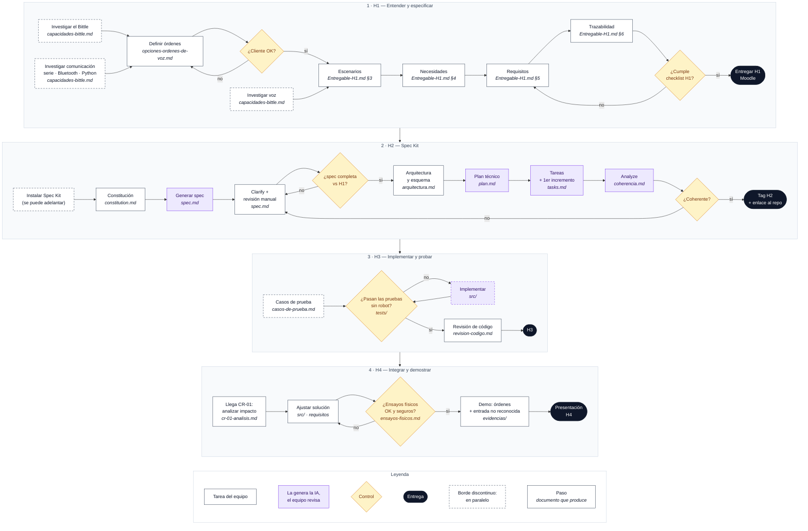

# Reto Bittle — IngenIA Robótica (curso 2026-2027)

> **Objetivo:** el robot Petoi Bittle debe obedecer órdenes de voz.

Cada empresa trabaja en un único repositorio Git, que recoge los documentos, el código y las evidencias. Hay cuatro hitos de revisión, y cada uno tiene su carpeta en este repo.

## Hitos

| Hito | Carpeta | Entregable | Contenido mínimo |
|---|---|---|---|
| **H1** · Especificación inicial | [`H1-especificacion-inicial/`](H1-especificacion-inicial/) | Escenarios y requisitos elaborados por el equipo | Escenario nominal y excepcional; requisitos verificables para las dos órdenes válidas y la entrada no reconocida; relación entre escenarios, necesidades y requisitos. |
| **H2** · Especificación y planificación con Spec Kit | [`H2-especificacion-planificacion/`](H2-especificacion-planificacion/) | `spec.md`, `plan.md` y `tasks.md` | Especificación revisada, decisiones técnicas justificadas, esquema sencillo del sistema, tareas organizadas y primer incremento identificado. |
| **H3** · Implementación y pruebas | [`H3-implementacion-pruebas/`](H3-implementacion-pruebas/) | Código ejecutable y pruebas en el repositorio | Implementación generada con apoyo de IA, revisión del código y pruebas reproducibles sin necesidad del robot físico. |
| **H4** · Demostración y aceptación | [`H4-demostracion-aceptacion/`](H4-demostracion-aceptacion/) | Sistema integrado y evidencias de funcionamiento | Demostración de las dos órdenes válidas y del tratamiento de una entrada no reconocida; pruebas físicas observadas; respuesta a la solicitud de cambio CR-01 y resultados documentados. |

## Itinerario

**Sesión 1**
1. **Comprender el encargo:** definir escenarios de uso nominales y excepcionales, e investigar.
2. **Especificar:** identificar necesidades y definir requisitos. → **H1**
3. **Explorar Spec Kit:** crear el repositorio, elegir el entorno, y generar y revisar `spec.md`.
4. **Planificar:** definir un esquema sencillo del sistema y obtener `plan.md` y `tasks.md`. → **H2**

**Sesión 2**

5. **Preparar la verificación:** diseñar casos de prueba.
6. **Implementar:** generar código con IA y hacer pruebas sin robot. → **H3**
7. **Integrar y adaptar:** analizar una solicitud de cambio, ajustar la solución y hacer ensayos físicos seguros.
8. **Demostrar:** verificar las dos órdenes válidas y el tratamiento de entradas no reconocidas; defender las evidencias. → **H4**

## Flujo de trabajo

Vista general de todos los hitos. Cada carpeta tiene su parte del flujo y la lista de pasos con casillas. Cada caja indica en cursiva el documento que produce. Leyenda debajo del diagrama.



## Reglas de trabajo (sesión del 26/10)

- Desarrollo basado en requisitos: **los requisitos y escenarios básicos los hace el equipo, no la IA.** La IA puede ampliarlos, corregirlos y cotejarlos, pero sin una base propia el resultado no funciona.
- Con Spec Kit (probado con Claude Code y Codex): **no dejarlo funcionar solo**, genera mucha basura.
- Reparto del tiempo: 50 % pensar (sesión 1, sin tocar el robot), 25 % implementar y 25 % demostrar.
- La presentación final recoge las fases seguidas, las decisiones tomadas y los highlights de cada fase.
- El profesor actúa como **cliente**. Los equipos trabajan de forma independiente, en modo competición. Se puede pedir reunión con el cliente en su despacho. La comunicación con el cliente es por **Teams**.

## Estructura del repo

```
H1-especificacion-inicial/        Entregable-H1.md (documento principal) · capacidades-bittle · opciones-ordenes-de-voz · entregables/ (Word)
H2-especificacion-planificacion/  constitution · spec · arquitectura · plan · tasks · coherencia
H3-implementacion-pruebas/        casos-de-prueba · src/ · tests/ · revision-codigo
H4-demostracion-aceptacion/       cr-01-analisis · ensayos-fisicos · evidencias/ · presentación
referencias/                      Enlaces a fuentes y notas de las sesiones
```
